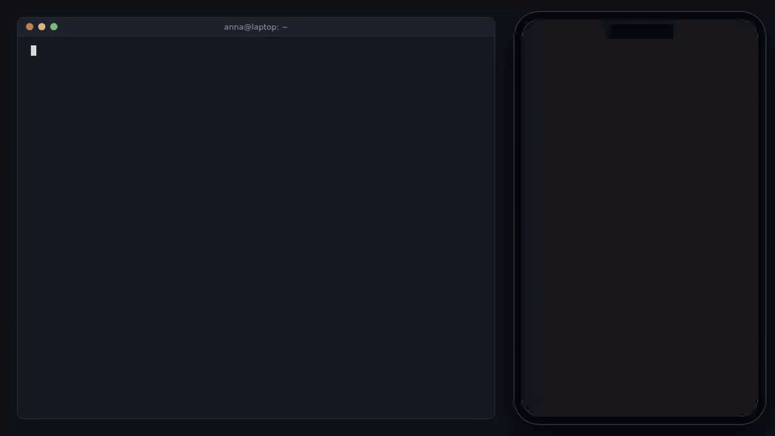
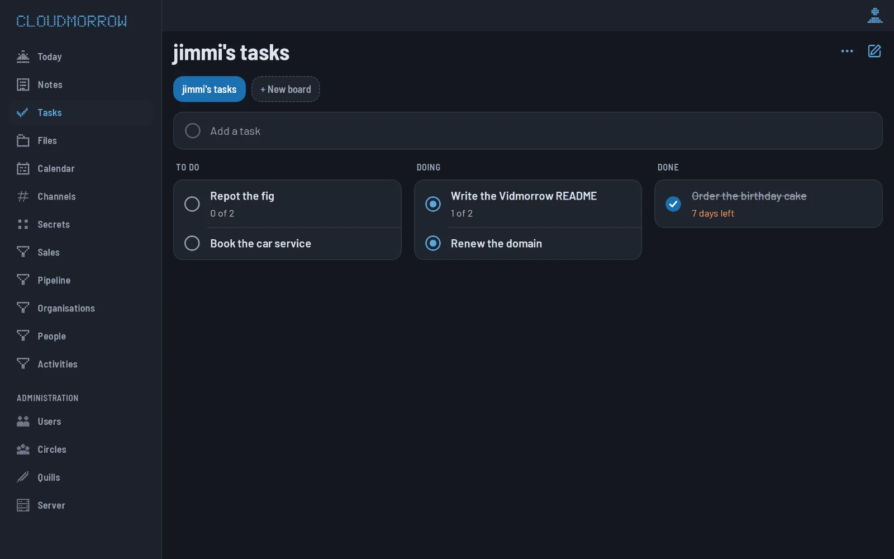
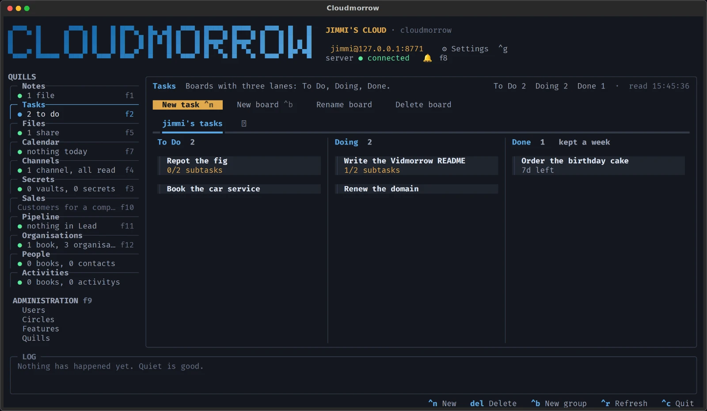
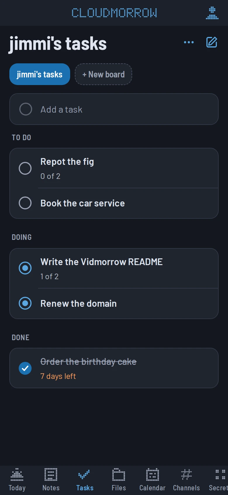
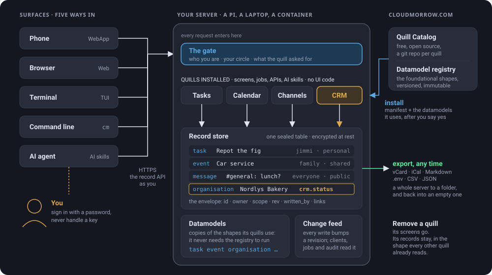

<p align="center">
  <a href="https://cloudmorrow.com"></a>
</p>

<h1 align="center">Cloudmorrow</h1>

<p align="center"><b>Keep your data. Change the software.</b></p>

<p align="center">
  A cloud you install on hardware you own. Your data stays on your machine, encrypted,
  in standard shapes every app agrees on. The apps around it, called Quills, you pick,
  change, share and throw away as your needs change: notes, tasks, calendars, files,
  conversations, mail, documents, spreadsheets, photos, video, an assistant.
</p>

<p align="center">
  <a href="https://cloudmorrow.com">Website</a> ·
  <a href="https://cloudmorrow.com/install">Install</a> ·
  <a href="https://cloudmorrow.com/quills">Quill Catalog</a> ·
  <a href="https://cloudmorrow.com/datamodels">Datamodels</a> ·
  <a href="docs/MANUAL.md">Manual</a> ·
  <a href="https://cloudmorrow.com/donate">Donate</a>
</p>

<p align="center">
  <a href="LICENSE"></a>
  <a href="https://github.com/Cloudmorrow/cloudmorrow/tags"></a>
  
</p>

<p align="center">
  <a href="docs/images/quill-build.mp4"></a>
</p>
<p align="center"><sub>An assistant writes a Quill, <code>cm quill install</code> puts it in the cloud, and the phone shows it. Nobody wrote a screen. (The terminal is replayed; the phone is the real app.)</sub></p>

<p align="center">
  
  
</p>
<p align="center">
  
  
</p>
<p align="center"><sub>One Quill, Tasks, as the kit draws it in the browser, in the terminal and on the phone, and the shape of the cloud behind them. Nobody wrote three screens: the Quill describes one, and every surface renders it, the command line and your assistant included.</sub></p>

## Install

A Linux machine with systemd and Python 3.11 or newer: a Raspberry Pi, an old
laptop, a NAS, a small VPS, a box in the server room.

```bash
curl -fsSL https://raw.githubusercontent.com/Cloudmorrow/cloudmorrow/main/deploy/install-server.sh | sudo sh
```

It asks six questions and it is running. Then:

1. Open the server's address in a browser and sign in.
2. On each computer, run the one line **Me → Add a device** shows. It installs
   the terminal app, `cm`, and the desktop app that mounts your shares.
3. On a phone, open `/app` and **Add to Home Screen**.

Every answer can be a flag, `--dry-run` says what it would do, and running it
again updates. Containers, reverse proxies, PostgreSQL, updates and backups
are in [docs/INSTALL.md](docs/INSTALL.md); the short version is at
[cloudmorrow.com/install](https://cloudmorrow.com/install).

## What is in the box

Every Quill below comes from the [Quill Catalog](https://github.com/Cloudmorrow/quill-catalog),
on the shelf the catalog keeps it on. Notes, Tasks, Calendar and Files are
the foundation, ticked on a fresh server; the rest are a tick away in the
installer or under Administration.

| Shelf | Quills |
| --- | --- |
| **Personal** | **Notes**: Markdown files in folders, with pictures, on your drive. **Files**: a drive per person and the shares a team keeps, mountable over WebDAV, with a Trash and backups of the folders on your own computers. **Morrow**: an assistant on your own cloud, a chat about anything you can see, and Quills of your own built when you ask. |
| **Productivity** | **Tasks**: boards with three lanes. **Calendar**: your own calendar, the shared ones and everybody's drawn together, and calendars subscribed from elsewhere by their address. **Cells**: small spreadsheets, formulas included, that read and write Excel. **Docs**: a basic Word over `.docs` files and Word's own. |
| **Communication** | **Channels**: a team's conversations with threads, mentions, reactions and push. **Messages**: conversations with one person or several. **Mail**: an inbox for everybody, name@your-cloud between you and your own domain to the world. **Slack**: a Channel and a Slack channel as one conversation. |
| **Creative** | **Media**: every photo and video in your drive as a wall, filtered and starred. **Clipper**: a video editor on the timeline kit. **Retouch**: a photo editor: crop, turn, resize, write on it. |
| **Games** | **Chess**: against the people on your cloud, or Morrow, who goes up a level each time you beat him; no limit, 10 or 5 minutes on the clock. |
| **Business** | **CRM**: organisations, people, a pipeline of deals, and what to do next. |
| **Developer** | **Secrets**: keys and passwords in sealed vaults, handed to a program with no file at all. **DevProject**: your software projects, with their `.env` secrets on every machine. |

And what the server itself brings, whichever Quills are on it:

| | |
| --- | --- |
| **Three ways in** | A web app made for the phone, the same app grown up for a laptop browser with a rail that folds, and a terminal app you can use with a mouse. One kit draws every Quill on all of them, on the command line as `cm <quill>`, and as tools for an assistant. Nobody writes three screens. |
| **The kit** | List, board, calendar, grid, editor, document, sheet, thread, timeline, gallery, photo, chess, data, and a view a Quill's code draws from primitives. Every row has the same right-click menu, every form the same fields, and an action that takes a while says so on its button. Pictured, element by element, in [docs/KIT.md](docs/KIT.md). |
| **People** | Accounts with a photo, a display name and a language; circles that say who may use which data; roles that say who is responsible. Me holds your photo, your favorites, your Quill switches and your devices. |
| **Spelling** | The cloud's own spellchecker, in a document and a note, with the dictionaries you pick from the catalog: seventeen languages, nothing sent anywhere. |
| **Told, not polled** | A bell in every app, Web Push to a phone's home screen and a computer's browser, a count on the icon. The apps hear the server: "updating" while it restarts, the menu changing as Quills come and go. |
| **An assistant, if you want one** | The server speaks MCP. Claude or any other client reads and writes your records as you, after you say yes. A Quill's own actions are tools too. Secrets are never on that list. |
| **Encrypted at rest** | Notes, messages, events, tasks and secrets are ciphertext on disk under one key the server holds. You sign in with a password and never handle a key. |
| **Backed up** | Name an S3 bucket, anybody's, and every day only what changed goes up. Restore any day, one person's files, or one file as it was. The agent on each computer backs its folders up to the server too. |
| **Somebody says yes** | Roles name who is responsible, flows ask them before a thing goes on, and a space's records can be frozen and signed by an outside party: the books at year end, validated by the accountant. |
| **Quills of your own** | Anybody may install a Quill for themselves, share it with people who say yes, and have it promoted to the whole server. The administrator sets the policy; the data is pooled for whoever holds it. |

## Quills

A Quill is a package: a manifest, a datamodel, screens described once, and
sometimes code. It has no UI of its own. Take one from the catalog, change it,
or make one with `cm quill new` and an assistant. Each one says what data it
touches and what it reaches on the internet before you say yes, carries its
own settings behind a gear beside its title, and takes its screens with it
when it goes. An add-on is a Quill that `requires` another, as Slack does
Channels.

How they are packaged, found and built: [docs/QUILLS.md](docs/QUILLS.md) and
[docs/QUILLCODE.md](docs/QUILLCODE.md). Start from
[quill-template](https://github.com/Cloudmorrow/quill-template). The shapes
every Quill agrees on live in [datamodels](https://github.com/Cloudmorrow/datamodels).

## How it is built

One FastAPI service with a database (SQLite, or PostgreSQL) and a folder of
files, a Textual terminal app, a plain HTML web app, and a small agent that
runs on each machine. No containers, no build step, no JavaScript framework.

```bash
uv venv && uv pip install -e '.[tui,server,dev]'
pytest
ruff check src tests
```

`cloudmorrow --dev` runs the checkout you are standing in against your real
server, so a change to the terminal app needs no deploy to try.

## Documentation

Using it:

- [docs/MANUAL.md](docs/MANUAL.md): every feature, command, config key and
  API route, with the reasoning behind them.
- [docs/INSTALL.md](docs/INSTALL.md): the server, the computers, the people,
  updates and backups.
- [docs/ENCRYPTION.md](docs/ENCRYPTION.md): what is encrypted, how, what it
  protects against and what it does not.
- [docs/CIRCLES.md](docs/CIRCLES.md): who may use which data.
- [docs/FLOWS.md](docs/FLOWS.md): roles, approvals, and the flows people
  build out of Quills' actions.
- [docs/ATTESTATIONS.md](docs/ATTESTATIONS.md): a frozen copy of a space's
  records with a digest, and an outside party's signed word on it.
- [docs/SHARING.md](docs/SHARING.md): Quills of people's own: shared,
  promoted, exported, and the policy for them.

Making Quills:

- [docs/QUILLS.md](docs/QUILLS.md): what a Quill is, its manifest, the
  kit of screens, the rules it keeps, and the catalog.
- [docs/QUILLCODE.md](docs/QUILLCODE.md): a Quill that runs code: views,
  actions, jobs, hooks, services, runtimes, the sandbox.
- [docs/KIT.md](docs/KIT.md): the kit's screens, pictured on the phone and
  on a computer, element by element.
- [docs/DATAMODELS.md](docs/DATAMODELS.md): the shape of the data: fields,
  versions, extensions, records, spaces.
- [docs/DOCS.md](docs/DOCS.md), [docs/CELLS.md](docs/CELLS.md),
  [docs/TIMELINE.md](docs/TIMELINE.md), [docs/PHOTO.md](docs/PHOTO.md): the
  document, sheet, timeline and photo kits, each a file format and an
  editor on every surface; [docs/CHESS.md](docs/CHESS.md), the chess kit,
  a board with clocks.

Why it is like this:

- [Concept.md](Concept.md): what Cloudmorrow is, in one page.
- [docs/DATA.md](docs/DATA.md), [docs/PLATFORM.md](docs/PLATFORM.md),
  [docs/HOSTING.md](docs/HOSTING.md): the data concept, the plan for the
  platform, and a hosted tenant.
- [docs/BACKLOG.md](docs/BACKLOG.md): work decided and not yet started,
  with the reasoning to begin from.
- [deploy/](deploy): the installer, the container, the systemd unit, and
  Caddy, nginx, server and agent examples.

## Contributing

Issues and pull requests are welcome; [CONTRIBUTING.md](CONTRIBUTING.md)
says how the repository works and what a good one looks like, and
[SECURITY.md](SECURITY.md) how to report a hole. Run `pytest` and
`ruff check src tests` before you push. If you add something that stores
what a person wrote, seal it; the last section of
[docs/ENCRYPTION.md](docs/ENCRYPTION.md) says how.

A release is a git tag on main (`vX.Y.Z`), and the only version number there
is. Every release writes its own notes and announces itself. `make deploy`
shows what is released and live and offers to release or deploy whatever is
behind; `make deploy WHAT=explain` says how the pieces fit.

## License

Cloudmorrow is free software under the [GNU Affero General Public License,
version 3](LICENSE), or any later version. Run it, change it, host it for other
people. If what you host is a changed version, offer them its source the way
this repository offers you this one.
