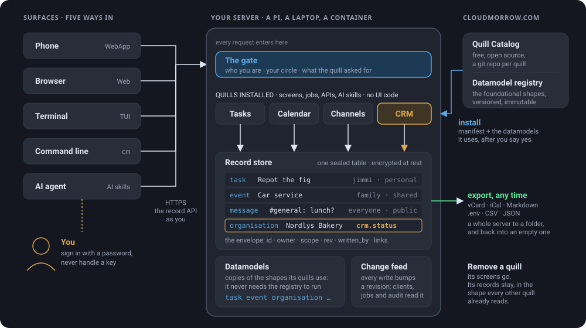

<p align="center">
  <a href="https://cloudmorrow.com"></a>
</p>

<h1 align="center">Cloudmorrow</h1>

<p align="center"><b>Keep your data. Change the software.</b></p>

<p align="center">
  A cloud you install on hardware you own. Your data stays on your machine, encrypted,
  in standard shapes every app agrees on. The apps around it, called Quills, you pick,
  change and throw away as your needs change.
</p>

<p align="center">
  <a href="https://cloudmorrow.com">Website</a> ·
  <a href="https://cloudmorrow.com/install">Install</a> ·
  <a href="https://cloudmorrow.com/quills">Quill Catalog</a> ·
  <a href="https://cloudmorrow.com/datamodels">Datamodels</a> ·
  <a href="docs/MANUAL.md">Manual</a> ·
  <a href="https://cloudmorrow.com/donate">Donate</a>
</p>

<p align="center">
  <a href="LICENSE"></a>
  <a href="https://github.com/Cloudmorrow/cloudmorrow/tags"></a>
  
</p>

<p align="center">
  
  
</p>
<p align="center">
  
  
</p>
<p align="center"><sub>One Quill, Tasks, as the kit draws it in the browser, in the terminal and on the phone, and the shape of the cloud behind them. Nobody wrote three screens: the Quill describes one, and every surface renders it, the command line and your assistant included.</sub></p>

## Install

A Linux machine with systemd and Python 3.11 or newer: a Raspberry Pi, an old
laptop, a NAS, a small VPS, a box in the server room.

```bash
curl -fsSL https://raw.githubusercontent.com/Cloudmorrow/cloudmorrow/main/deploy/install-server.sh | sudo sh
```

It asks six questions and it is running. Then:

1. Open the server's address in a browser and sign in.
2. On each computer, run the one line **Me → Add a device** shows. It installs
   the terminal app, `cm`, and the desktop app that mounts your shares.
3. On a phone, open `/app` and **Add to Home Screen**.

Every answer can be a flag, `--dry-run` says what it would do, and running it
again updates. Containers, reverse proxies, PostgreSQL, updates and backups
are in [docs/INSTALL.md](docs/INSTALL.md); the short version is at
[cloudmorrow.com/install](https://cloudmorrow.com/install).

## What is in the box

| | |
| --- | --- |
| **Notes, Tasks, Calendar, Files** | The foundation, ticked on a fresh server. Markdown files in folders; boards with three lanes; your calendar and the shared ones drawn together; a drive per person and shares a team keeps, mountable over WebDAV. |
| **Channels, Secrets** | Standard too: a team's conversations with threads, mentions and push notifications; keys and passwords in sealed vaults, handed to a program with no file at all. |
| **Every other Quill** | From the [Quill Catalog](https://github.com/Cloudmorrow/quill-catalog): CRM, Cells, Docs, Media, CutMorrow, DevProject. Each says what data it touches before you say yes, and takes its screens with it when it goes. |
| **Three ways in** | A web app made for the phone, the same app grown up for a laptop browser, and a terminal app you can use with a mouse. One kit draws every Quill on all of them, and on the command line. |
| **An assistant, if you want one** | The server speaks MCP. Claude or any other client reads and writes your records as you, after you say yes. Secrets are never on that list. |
| **Encrypted at rest** | Notes, messages, events, tasks and secrets are ciphertext on disk under one key the server holds. You sign in with a password and never handle a key. |
| **Backed up** | Name an S3 bucket, anybody's, and every day only what changed goes up. Restore any day, one person's files, or one file as it was. |
| **Somebody says yes** | Roles name who is responsible, flows ask them before a thing goes on, and a space's records can be frozen and signed by an outside party: the books at year end, validated by the accountant. |

## Quills

A Quill is a package: a manifest, a datamodel, screens described once, and
sometimes code. It has no UI of its own. Take one from the catalog, change it,
or make one with `cm quill new` and an assistant. Anybody on the server may
have Quills of their own, shared with people who say yes.

How they are packaged, found and built: [docs/QUILLS.md](docs/QUILLS.md) and
[docs/QUILLCODE.md](docs/QUILLCODE.md). Start from
[quill-template](https://github.com/Cloudmorrow/quill-template). The shapes
every Quill agrees on live in [datamodels](https://github.com/Cloudmorrow/datamodels).

## How it is built

One FastAPI service with a database (SQLite, or PostgreSQL) and a folder of
files, a Textual terminal app, a plain HTML web app, and a small agent that
runs on each machine. No containers, no build step, no JavaScript framework.

```bash
uv venv && uv pip install -e '.[tui,server,dev]'
pytest
ruff check src tests
```

`cloudmorrow --dev` runs the checkout you are standing in against your real
server, so a change to the terminal app needs no deploy to try.

## Documentation

- [docs/MANUAL.md](docs/MANUAL.md): every feature, command, config key and
  API route, with the reasoning behind them.
- [docs/INSTALL.md](docs/INSTALL.md): the server, the computers, the people,
  updates and backups.
- [docs/QUILLS.md](docs/QUILLS.md): what a Quill is, its manifest, the
  kit of screens, the rules it keeps, and the catalog.
- [docs/QUILLCODE.md](docs/QUILLCODE.md): a Quill that runs code: views,
  actions, services, runtimes, the sandbox.
- [docs/TIMELINE.md](docs/TIMELINE.md): the timeline kit, a video editor.
- [docs/CELLS.md](docs/CELLS.md): the sheet kit, a spreadsheet of cells and
  formulas on every surface.
- [docs/SHARING.md](docs/SHARING.md): Quills of people's own: shared,
  promoted, exported, and the policy for them.
- [docs/DATAMODELS.md](docs/DATAMODELS.md): the shape of the data: fields,
  versions, extensions, records, spaces.
- [docs/CIRCLES.md](docs/CIRCLES.md): who may use which data.
- [docs/FLOWS.md](docs/FLOWS.md): roles, approvals, and the flows people
  build out of Quills' actions.
- [docs/ENCRYPTION.md](docs/ENCRYPTION.md): what is encrypted, how, what it
  protects against and what it does not.
- [docs/ATTESTATIONS.md](docs/ATTESTATIONS.md): a frozen copy of a space's
  records with a digest, and an outside party's signed word on it.
- [Concept.md](Concept.md): what Cloudmorrow is, in one page.
- [docs/DATA.md](docs/DATA.md), [docs/PLATFORM.md](docs/PLATFORM.md),
  [docs/HOSTING.md](docs/HOSTING.md): the data concept, the plan for the
  platform, and a hosted tenant.
- [deploy/](deploy): the installer, the container, the systemd unit, and
  Caddy, nginx, server and agent examples.

## Contributing

Issues and pull requests are welcome. Run `pytest` and `ruff check src tests`
before you push. If you add something that stores what a person wrote, seal
it; the last section of [docs/ENCRYPTION.md](docs/ENCRYPTION.md) says how.

A release is a git tag on main (`vX.Y.Z`), and the only version number there
is. `make deploy` shows what is released and live and offers to release or
deploy whatever is behind; `make deploy WHAT=explain` says how the pieces fit.

## License

Cloudmorrow is free software under the [GNU Affero General Public License,
version 3](LICENSE), or any later version. Run it, change it, host it for other
people. If what you host is a changed version, offer them its source the way
this repository offers you this one.
