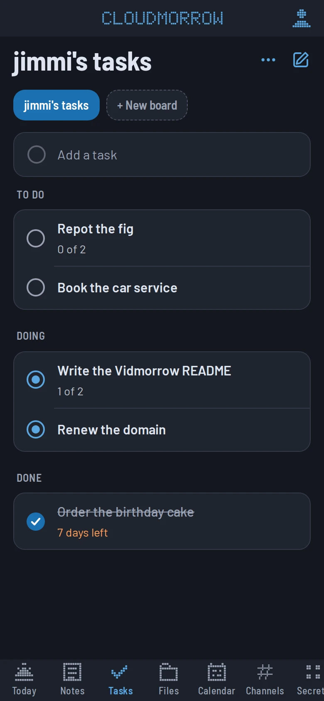
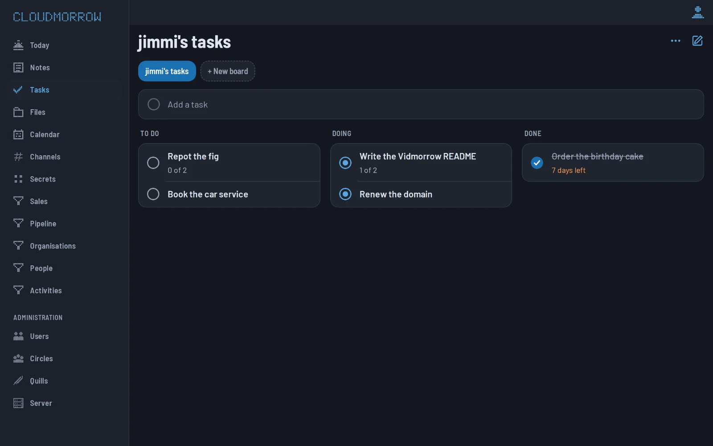
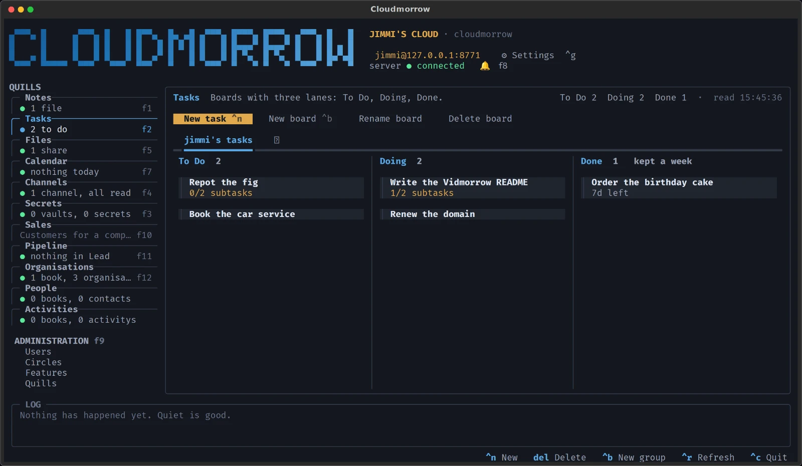

# Cloudmorrow manual

The long-form reference: every feature, every command, every config key,
and the reasoning behind them. If you just want to get a server running,
start with the [README](../README.md); this is the page to come back to.

Cloudmorrow is one thing on three surfaces — the **web app** (on a phone,
in a browser, and in the desktop app), the **terminal app**, and the
**command line** — and every how-to here shows all three, under headings
of their own: *In the web app*, *In the terminal app*, *On the command
line*. On [cloudmorrow.com](https://cloudmorrow.com/guide) they are tabs:
pick one and the whole guide follows.

Notes, Tasks, Calendar, Channels and the rest are Quills — software from
the [Quill Catalog](https://cloudmorrow.com/quills) — and each one's own
guide is on its page there. This manual is the platform under them, and
mentions them only as examples.

## What it does

- **Secrets.** Your keys and passwords, in **vaults** you name (`default`
  until you name one) and environments inside them (`local`, `production`,
  whatever you call them), encrypted at rest. `.env` files in and `.env`
  files out, `secret run` to hand them to a process without a file, and
  values never in a listing unless you ask. Part of the foundation: an app
  is *given* a secret when you say so, and never owns one.
- **Quills.** Everything beyond the foundation is a Quill from the
  [Quill Catalog](https://cloudmorrow.com/quills): Notes, Tasks, Calendar,
  Channels, Files and Secrets on a fresh server, and whatever is there next.
  One description is a tab on the phone, in the browser and in the terminal,
  a `cm <quill>` command, and tools for an assistant. Each Quill's own guide
  is on its catalog page; see [Quills](#quills) for how they are added, used
  and made.
- **A terminal app you can click.** `cm` on its own opens the workspace: a
  card per Quill — Notes, Tasks, Files, Calendar, Channels, Secrets — because
  those are the kinds of thing there are. A vault is a row in a list, the
  same shape as a note, and its keys are beside it. Every row and button is a
  click target with a key beside it. The markdown editor is live: the line the
  cursor is on stays raw source, and every other line renders as you leave it.
- **Encrypted at rest.** Everything you write into the database — chat,
  events, tasks, secrets, synced dotfiles — is ciphertext on the server's
  disk, under one key the server holds. You never handle a key; you sign in
  with a password. See [Encryption at rest](#encryption-at-rest).
- **Files are files.** Your drive on the server is a folder: a note the
  Notes Quill writes is a Markdown file in its `Notes` folder, folders are
  folders, and a copy of the tree is a backup. `grep` works, `rsync` works,
  and so does any editor.
- **A local agent** on each machine — registers itself when you sign in, runs
  as you, for backups and whatever comes next. The server has one too, so the
  box that holds everything is in the list with the rest of them.
- **My Files.** A drive of your own on the server, there because your
  account is: `cloudmorrow share mount my-files` and it is a folder on this
  machine; in the app it is the first thing under Files.
- **Fileshares.** A folder on the server with a name, served over WebDAV,
  and shared with the people and circles you pick — to change what is in it,
  or only to read it. Anybody makes one; an administrator may also share
  with everybody, and put a share on another directory on the server. It is
  mounted on whichever machine you are at: `cloudmorrow share mount media`
  and it is `~/Fileshares/media` here, or `/Volumes/media` on a Mac. Finder
  does the mounting on macOS with nothing installed; on Linux it is
  `rclone`. Made, shared and mounted from the **Files** tab as well, which
  is the Files Quill: the files themselves stay where they are.
- **The count on the icon.** Channels is why the web app has push. An app
  on a home screen is not running most of the time, so nothing it could poll
  would keep its badge right — a real Web Push wakes a service worker, which
  shows the banner and sets the number. The badge is everything waiting:
  what is unread in the spaces you are in plus unread notifications. See
  [Push notifications](#push-notifications).
- **Users.** Password login, bearer tokens, per-user trees, and an admin API for
  creating more accounts. Every account has a **role** — Administrator, User,
  or DashboardDisplayer, which may only show dashboards on a shared screen —
  and a **type**, which is what is behind it rather than what it may do:
  Human, Agent, or SystemsUser for the machinery itself.
- **Administration.** An administrator has one more thing on the top bar of
  the terminal app, left of Settings: Administration, which puts the whole workspace
  aside for the server's own panel — and the same panel is in the web app,
  behind a row in **Me** that only administrators are shown. **Users** is
  every account, added and edited there. **Quills** is what this server
  offers: every Quill installed, whether it is on and whether its code is
  running, the ones people added for themselves, and the catalog. Each
  Quill's sheet has its switch: off, and its tab is gone from every client
  and its API answers 403, because off ought to mean off rather than hidden.
- **And a switch of your own.** The same list is in your own settings, in
  the terminal app and in **Me** on the phone, with your answer on each.
  Switching one off there takes its tab out of your clients, on every
  machine you sign in from — an account that never opens Calendar can stop
  being offered it. Only what the server offers is listed: a feature an
  administrator has switched off is not something you are shown at all,
  because a tick box you cannot have an opinion about is worse than no tick
  box. Yours hides where theirs forbids; see [Two switches on every
  feature](#two-switches-on-every-feature).
- **One install command**, served by the server itself at `/`.
- **Claude can use it as you.** The server is an MCP server too, at `/mcp`,
  with OAuth in front of it: add the address to Claude Desktop, claude.ai or
  Claude Code, sign in on the page that opens, and from then on "put milk on
  my shopping list" or "what did I write about the greenhouse" is a tool call
  on your own records — and only yours. Nothing to
  configure, and every assistant you let in can be cut off again; see
  [An assistant working as you](#an-assistant-working-as-you).
- **The web app.** The same server serves it at `/app`: sign in, and every
  Quill is a tab, laid out the way a phone's apps are — a list, then the
  thing — and on a computer with a rail down the left. Add it to the home
  screen and it opens like an app. The pixel B in its bar says which
  app you are in. It follows a deploy on its own: an app on the home screen
  is opened and hidden for weeks without ever being loaded, so the page asks
  which deploy the server is serving whenever it comes back to the front,
  and reloads itself when the answer has changed — with no force close, and
  never out from under something you are writing.

## Three ways in

One server, one account, three ways to use it — and all three show the
same records the moment they change:

- **The web app**, at `<your server>/app`: on a phone (add it to the home
  screen), in any browser, and in [the desktop app](#the-desktop-app),
  which is the same page in a window of its own.
- **The terminal app**, `cm` with nothing after it: the workspace in a
  terminal, with a mouse and with keys.
- **The command line**, `cm <resource> <action>`: for scripts, pipes, and
  the hundredth time in a day.

A Quill is a tab in the first two and a command in the third, from one
description. Nothing is kept from a surface on purpose — only by what the
surface can do: a browser cannot mount a share, and a terminal has no
camera.

The Tasks Quill, on each:







**Signing in.** The same username and password everywhere.

#### In the web app

Open `https://<your server>/app` and sign in. The token stays in the
browser for as long as the server's `token_ttl_hours` says (thirty days by
default), so it is one sign-in, not one per visit. On a phone, share-sheet
→ **Add to Home Screen** makes it an app of its own: an icon, no browser
chrome, and it opens where you left it.

#### In the terminal app

`cm` opens the workspace. The first time it asks for the server's address,
your username and your password, and keeps all three — in
`~/.config/cloudmorrow/`, where the command line finds them too — so the
next `cm` opens straight on your notes.

#### On the command line

```sh
curl -fsSL https://<your server>/install.sh | sh   # once per machine: cm, the terminal app, the desktop app
cm login -u ada                                     # asks for the password; with no server set, finds one on the home network
cm whoami                                           # who you are, where, and the default vault
```

---

**Adding a device.** Everything a new device needs, at the address you are
signed in to: a computer runs the install command, a phone opens `/app`
and is added to the home screen, an assistant that speaks MCP is given
`/mcp`.

#### In the web app

**Me → Add a device**: the command to copy for a computer, a QR code for a
phone, and the address for an assistant.

#### In the terminal app

**Settings** (`ctrl+g`) → **Add a device**: the same, as text to copy.

#### On the command line

The install command *is* the device being added:

```sh
curl -fsSL https://<your server>/install.sh | sh
cm login
```

---

**Where things are.** The same thing, on each surface:

| | the web app | the terminal app | the command line |
| --- | --- | --- | --- |
| a Quill | its tab | its card (`f1`, `f2`, …) | `cm <quill> list`, `add`, `show`, … |
| one record | tap its row: the sheet | `enter` on its row: the sheet | `cm <quill> show <id>` |
| you, and your switches | **Me**, top right | **Settings**, `ctrl+g` | `cm whoami`, `cm config` |
| what the machines did | not yet | the bell, `f8` | `cm agent list`, `cm agent jobs <id>` |
| administration | **Administration** in the rail on a computer; **Me → Administration** on a phone | **Administration**, `f9` | `cm circle`, `cm quill`; accounts with `cloudmorrow-server user` on the box |

## Layout

```
src/cloudmorrow/
  logo.py            the wordmark, shared by every entry point
  paths.py           path validation (nothing escapes the notes root)
  dotenv.py          the .env format, and the default vault and environment, shared by both ends
  slugs.py           ids for boards and shares, derived the same way on both ends
  palette.py         the colours, named once, for the TUI and the CLI alike
  cli/               the `cloudmorrow` command line, one module per resource
    dev.py           `--dev`: run the checkout you are standing in
    progress.py      the spinner, the bar, and the line saying what is happening
    secret.py        list, get, set, remove, import, export, run, vaults
    share.py         list, show, add, with, unshare, leave, move, remove, mount, unmount
  client/            talking to a server: config, credentials, HTTP
    mounts.py        which share is mounted where on this machine, and by what
  server/            FastAPI app, the stores and the database layer under them
    types.py         the kinds of data there are, who provides each, and who reaches it
    settings.py      what the server was told about itself from the app: its name
    crypto.py        sealing secret values (AES-256-GCM)
    secrets.py       the secret store: vaults, environments, keys
    tasks.py         boards, lanes, and the week a finished task has left
    notifications.py what the machines did, kept where all of them can leave it
    webpush.py       VAPID, aes128gcm, and the devices to push
    shares.py        the fileshares: a name, a folder, whose it is and who it is shared with
    dav.py           those directories over WebDAV, at /dav/<share>/
    templates/       the install page and install.sh
    web/             the app for the browser: one page, a core, and a file per feature
  agent/             the local agent: config, tasks, poll loop
  desktop/           the desktop app: the web app in a pywebview window, and the
                     bridge that lets it mount shares here (`cloudmorrow app`)
  tui/               Textual client
    theme.py         the Textual theme, built from that palette
    screens/         splash, login, the workspace, and settings
    panes/           the kit (kit_*.py: list, grouped list, board, editor, grid, calendar),
                     files (local backups + fileshares), and browse: what is
                     in a share, as a list or as thumbnails
    widgets/         the vault list, the note tree, the board, the toolbar,
                     the editor, and the picture beside it
deploy/              server installer, systemd unit, Caddy/nginx, example config
scripts/
  release.py         tag this commit as a release, and push it
```

Notes on disk, one tree per user, in the `Notes` folder of their drive:

```
<notes_dir>/<user>/files/Notes/
```

Notes are the person's, not a project's, so there is one tree and no scoping
to think about. A note is a plain Markdown file like any other file in the
drive: it shows in My Files and on WebDAV, and any editor can open it.

Secrets are the exception to files-not-a-database: they live in the
database, encrypted — see [Secrets](#secrets).

## The command line

Everything reads `cloudmorrow RESOURCE ACTION`, with singular resource names:

```
cloudmorrow secret  list | get | set | remove | import | export | run | vaults
cloudmorrow agent   list | run | jobs | enroll-token
cloudmorrow share   list | show | add | with | unshare | leave | move | remove | mount | unmount
cloudmorrow config  show | set
cloudmorrow update  [server | all]
cloudmorrow snapshot take | list | show | bundle | attest | guest | guests | revoke | withdraw | verify
cloudmorrow attest  sign | verify | key
```

`cm` is the same command in two letters — `cm notes list`, or `cm` on its own
for the terminal app — for the hundredth time in a day. An update never overwrites a
`cm` that is somebody else's program.

No invented syntax, no arrows. Data goes to stdout, status goes to stderr,
and `-v`/`-e` are overrides on commands that have a sensible default without
them. The old plural names (`cloudmorrow agents list`) still
work, quietly, so old muscle memory and old scripts do not break — except
`cloudmorrow notes` and `cloudmorrow secrets`, which are the Notes and
Secrets Quills' now (`cm notes list`, `cm secrets list`, through the kit);
`cloudmorrow secret` is as it always was.

## Server, on the home box

One script, run as root on the home box. It asks what the cloud is called,
who the first account is, where it goes, which addresses it answers on,
which database it keeps its records in and which standard quills it has,
then clones the repo, builds a venv, writes the config and the systemd
unit, generates the sealing key, starts the service, creates that account
as administrator and gives the server an agent of its own.

```bash
curl -fsSL https://raw.githubusercontent.com/Cloudmorrow/cloudmorrow/main/deploy/install-server.sh | sudo sh
```

The questions are asked on the terminal, not stdin, so the script can arrive
through a pipe. Every answer has a flag, and with all three given nothing is
asked, which is what a script or a re-run wants:

```bash
sudo sh deploy/install-server.sh \
  --name "The Larsens" \
  --public-url https://cloud.example.com \
  --user alice                    # password from $CLOUDMORROW_ADMIN_PASSWORD, or asked
```

Add `--dry-run` to read what it is about to do without doing any of it, or
asking anything. `--repo` deploys a fork; from a checkout it defaults to
that checkout's origin, and on its own to the public repository.

Installing from a private fork instead: give `--repo` an ssh URL and the script
does the deploy-key dance — the first run generates a read-only key and stops,
you add it under the repository's deploy keys, and the second run does the
install. (Cloning by hand first cannot work: that is the access the key is
about to grant.)

What it leaves behind:

| path | |
| --- | --- |
| `/opt/cloudmorrow/src` | the git checkout the service runs from |
| `/opt/cloudmorrow/venv` | its virtualenv, installed editable so updates are a pull |
| `/etc/cloudmorrow/server.toml` | the config — yours to edit, never rewritten |
| `/etc/systemd/system/cloudmorrow.service` | runs as the `cloudmorrow` system user |
| `/usr/local/bin/cloudmorrow-update` | the updater, below |
| `/usr/local/bin/cm` | the terminal app, here on the server too (`cloudmorrow` beside it is the same command) |
| `/etc/sudoers.d/cloudmorrow` | lets `--admin` run exactly what the updater needs: the update as the service user, the restart, and linking `cm` |
| `/var/lib/cloudmorrow/.ssh/` | the deploy key the service pulls with, if the repo needed one |
| `/etc/cloudmorrow/cloudmorrow.key` | the key everything is sealed with at rest |
| `/etc/cloudmorrow/postgres.pgpass` | the database password, when the installer ran PostgreSQL in a container |

Re-running the script is safe: it puts the checkout on the remote branch,
reinstalls, and leaves your config, notes, database and accounts alone. It
reads the name, address and database back out of the existing config
rather than asking again, and asks for an account only while the server
has none. On a server that is running and answering it asks first
whether to update it, and Enter says yes; `--update` skips the question,
and without a terminal a server that is well is left as it is.

**The terminal app is on the server too.** `cm` at the box opens it, you
sign in with your own name and password, and an administrator has
Administration on the top bar, as on any other machine. It needs no
address: a client on the server with no config of its own reads where the
server listens off `/etc/cloudmorrow/server.toml` (or wherever
`CLOUDMORROW_SERVER_CONFIG` says) and reaches it there — loopback when it
answers there or on every address, else the first address it was given —
whichever addresses were chosen at install, and whether or not a proxy
and a `public_url` sit in front. Plain http to an address the server here
listens on is this machine, so nothing has to be allowed. `cm login
--server`, or `cm config set api_url`, points it somewhere else as on any
machine, and then that config wins. Signing in on the server enrols no
agent: the box has the server's own already, and it is the machine's.

### The database

The records, the accounts and everything else that is not a file live in
one database, and the installer asks which: the built-in one, a SQLite
file at `/var/lib/cloudmorrow/cloudmorrow.db`, which is right for a
household or a company and needs nothing else on the machine; or
PostgreSQL. `--database container` runs PostgreSQL beside the server as
the container `cloudmorrow-postgres` (docker or podman), with a password
made once and kept at `/etc/cloudmorrow/postgres.pgpass`, and a dump of it
written into `/var/lib/cloudmorrow/postgres/` every day by
`cloudmorrow-pgdump.timer`, so whatever backs up the data directory
carries the database with it. `--database postgresql://…` is a server you
already run, reached once before anything is written. Either way the
answer is `database_url` in `server.toml`, blank for the built-in one; the
server reads `CLOUDMORROW_DATABASE_URL` in a container. The choice is made
at install: the records do not move from one database to the other.
[HOSTING.md](HOSTING.md), *The database*, says what each is for.

### The cloud's name

`name` in `/etc/cloudmorrow/server.toml` — what the installer's first
question wrote — is on the sign-in screen, the install page, the phone's
home screen (through the manifest and the Apple title), the page title, and
`/api/health`. It is text, never markup, and blank means "Cloudmorrow".
Change it by editing the config and `sudo systemctl restart cloudmorrow`; a
phone that already has the app on its home screen keeps the name it was
added under until it is added again.

### First boot in the browser

Skip the account question, or run the installer with no terminal, and the
server is set up on its first visit instead. While it has no accounts,
`/`, `/install` and `/app` all redirect to `/setup`: one form for the
cloud's name and the first account, posted to `/api/setup`, which makes
that account the administrator and sends the browser to the app. The
moment any account exists the page redirects to `/app` and the endpoint
answers 409, so there is nothing to find afterwards. `/api/health` says
`"setup": true` until then, for a client that wants to send somebody there.

The name set this way lives in the database, and wins over the one in the
config file: a running service cannot write `/etc`, and a hosted tenant
has no file to edit. An administrator changes it later with
`PATCH /api/server/settings` and `{"name": "…"}`; anybody signed in may
`GET` it. [HOSTING.md](HOSTING.md) is where this leads: a tenant somebody
bought is "open it and fill in the setup page".

### As a container

`deploy/docker/` builds the server into one image, with `/data` and
`/keys` as its two volumes and every config key an environment variable.
`compose.yml` puts Caddy in front of it for the certificate, and the first
visit is the setup page above. The database is the built-in one in the
data volume unless the `postgres` profile is on, which runs PostgreSQL as
a third container on a volume of its own (`COMPOSE_PROFILES=postgres
POSTGRES_PASSWORD=… docker compose up -d`), or `CLOUDMORROW_DATABASE_URL`
names a server of your own. Updating is replacing the image, so
`allow_api_update` is off inside it, and `FORWARDED_ALLOW_IPS=*` (the
same as `trusted_proxies = ["*"]`) lets uvicorn believe a proxy that is
another container rather than the loopback. The wheel the image was built from is copied into `/data/dist`
on every start, so `/install.sh` hands out the code that is running.

Accounts can also be made from the server at any time; the first one on a
server is its administrator whatever flags it is given:

```bash
sudo -u cloudmorrow /opt/cloudmorrow/venv/bin/cloudmorrow-server user create sam
```

`--password-stdin` reads the password from stdin instead of prompting, for
a script, and `user list --count` prints how many accounts there are, which
is how the installer knows whether to ask.

### Moving an install from BramCloud

Everything was renamed at once — the package, the commands, the paths, the
environment variables, the units — so an existing install carries on as
BramCloud until you move it. Do not run the old `bramcloud update server`
against the renamed code: it would pull it and then restart a unit whose
command no longer exists. Instead, on the server:

```bash
sudo sh deploy/migrate-from-bramcloud.sh --public-url https://cm.hl.bramlabs.io --admin jimmi
```

It stops the old units, moves `/etc`, `/var/lib`, `/opt` and the database to
their new names, renames the system user, rewrites the paths and `public_url`
in the config, fetches the renamed code and hands over to
`install-server.sh`, which writes the new unit, updater and sudoers file and
rebuilds the venv. The signing, secrets and VAPID keys move with the data
directory, so accounts, tokens, secrets and push subscriptions survive; notes
stay where `notes_dir` points.

Then, on each machine, `sh deploy/migrate-client.sh https://cm.hl.bramlabs.io`
installs the `cloudmorrow` client, keeps your sign-in and project links, and
retires the old `bramcloud` one. The phone app stores its token under a new
key, so it asks you to sign in once more.

### The URLs

Three places, and only the first two matter for a normal setup:

- **`public_url`** in `/etc/cloudmorrow/server.toml` — `https://cm.hl.bramlabs.io`.
  The install page bakes this into the command it hands out, so it must be the
  address other machines use, not the bind address.
- **your reverse proxy** — point it at whatever `--host`/`--port` the service
  listens on. On one box that is `127.0.0.1:8787`:

  ```
  cm.hl.bramlabs.io {
  	reverse_proxy 127.0.0.1:8787
  }
  ```

  The server listens on every address by default, so
  `http://<its IP>:8787` answers on the network too, and a proxy on a
  *different* machine reaches it directly (`--host 127.0.0.1` keeps it to
  a proxy on the same box; `--host "127.0.0.1, 192.168.1.5"` answers on
  both, and the installer offers the machine's addresses as boxes to tick):

  ```
  cm.hl.bramlabs.io {
  	reverse_proxy 100.71.157.19:8787
  }
  ```

  A proxy on a different machine also has to be **trusted**, or the server
  takes everything through it for plain http — refused with 426 once
  `public_url` is https:

  ```toml
  trusted_proxies = ["100.115.4.117"]   # the proxy's address, as the server sees it
  ```

  Addresses or CIDR ranges, or `"*"`; the loopback is always trusted, so a
  proxy on the same box needs nothing. `--trusted-proxy` on the installer
  writes it. What a trusted proxy says in `X-Forwarded-Proto` and
  `X-Forwarded-For` is believed; from anyone else those headers are ignored.
  One thing needs neither: the address the install page shows, the script
  bakes in and `cm` signs in to is taken from `X-Forwarded-Proto` and
  `X-Forwarded-Host` (or `Forwarded`) whoever sent them, because they change
  only the address handed back to the one who asked. So an untrusted proxy
  still hands out an `https://` command; it just cannot let the sign-in
  through until it is trusted or `public_url` is set.

- **each client** — `cloudmorrow config set api_url https://cm.hl.bramlabs.io`,
  which the install script does for you.

Change `public_url` later by editing the config and
`sudo systemctl restart cloudmorrow`.

### Answering only the proxy

On a machine that also serves other things, a host firewall can be more trouble
than it is worth. `allowed_client_ips` narrows the API instead:

```toml
allowed_client_ips = ["192.168.10.88"]   # just the reverse proxy
```

Addresses or CIDR ranges, matched against the real TCP peer — never
`X-Forwarded-For`, which the caller sets and could therefore forge. Everything
else gets a 403, including the install page and login. Empty (the default)
allows anyone who can reach the port.

It does not replace the login: whatever can reach the proxy can still reach the
API through it. It stops everything else on the LAN from talking to the port
directly.

### Updating after you push

Push, then deploy. From your laptop, if your account is an admin:

```bash
cloudmorrow update server
```

That goes through the API — no shell on the server, no ssh agent, nothing to
type but the command. The server puts its own checkout on whatever the remote
branch says, reinstalls in case dependencies moved, rebuilds the client wheel,
and restarts onto the new code; the command waits for it to come back and
prints the commit it came back on. With nothing new to pull it says so and
stops.

So a release is two things:

```bash
python scripts/release.py   # tag this commit, push the code and the tag
cloudmorrow update server     # the server runs it, and republishes the wheel
```

`cloudmorrow update all` does that second line and the `cloudmorrow update` that
usually follows it, in one go.

### Versions

The version is a git tag. Nothing writes it down — `pyproject.toml` reads it
back off the nearest `vX.Y.Z` behind `HEAD` — so there is no number in a file
to go stale and no way for it to disagree with the history it claims to
describe.

One bump per push: every push of new code is a release and takes the next
minor, which is what `scripts/release.py` does. A major is the only thing
anyone decides:

```bash
python scripts/release.py            # 0.6.0 → v0.7.0
python scripts/release.py --major    # 0.6.0 → v1.0.0
python scripts/release.py --dry-run  # say what it would do
```

It refuses on a dirty tree, and refuses to tag a commit that is already a
release — a push with nothing new in it is not one. The tag and the commits go
up together (`git push --follow-tags`), so the remote never holds code whose
release has not arrived.

Between releases the version says so: a commit past `v0.7.0` builds as
`0.8.0.dev3+g1c91c8b` — the release being worked towards, how far past, and
which commit. Anything with `.dev` in it is not a release, and the deploy
output names it by its commit rather than dressing it up as one.

The commit hash has not gone away, and should not: a version only changes when
a tag does, so it cannot prove a process restarted onto new code. That is what
`/api/health` still reports a commit for, and what `cloudmorrow update server`
compares when it waits for the server to come back. The version is what you
read; the commit is what is checked.

Nothing on the server watches git, by design — a push on its own deploys
nothing, and the deploy is a thing you do at a moment you choose.

**What restarts it, given the service has no privileges.** The service user
owns `/opt/cloudmorrow` and the deploy key, so the pull and the reinstall are
just it working on its own files. The restart it genuinely cannot do — so it
does not try: it stops itself, and systemd starts it again on the new code.
That is what `Restart=always` in the unit is for, and the server checks the
unit says so *before* it stops — otherwise a deploy would take the API down
until someone walked over to the box. `systemctl stop cloudmorrow` still stops
it for good; systemd knows the difference between that and an exit.

**What it trusts.** An admin token can change the code the server runs. That
is a real step up from what a token could do before, and worth deciding
deliberately rather than inheriting. What bounds it is git: the deploy is
`git reset --hard origin/<branch>`, so it can only run a commit that is
already pushed to the repository — not code of the caller's choosing. If that
is still more than you want a bearer token to do:

```toml
allow_api_update = false    # in /etc/cloudmorrow/server.toml
```

and the endpoint answers 403 for everyone.

**The way in when the API is the problem.** A bad deploy is exactly when you
cannot use the API to fix it, so the ssh path stays:

```bash
cloudmorrow update server --ssh
```

or, from your own account on the server, no sudo password and no root shell:

```bash
cloudmorrow-update
```

Those drive the same update over ssh instead, authorised by your ssh access
plus the sudoers rule the installer wrote rather than by a token. `--host`
takes any ssh target when the API hostname is not the one you ssh to (an ssh
alias, a tailnet name); make it permanent with
`cloudmorrow config set server_host <target>`.

Either way it refuses to run if the checkout has uncommitted changes or if
history has diverged, rather than merging on your behalf; `--force` overrides
the first of those, `--branch` deploys something other than the current branch,
and `--no-restart` leaves the new code on disk with the old code still serving.

Under the hood the ssh path is `cloudmorrow-server update`, which also takes
`--source` if you need it. The checkout belongs to the service user, and git
refuses to touch a checkout owned by somebody else ("dubious ownership"), so
`cloudmorrow-server update` run as root does what `cloudmorrow-update` does:
the update as the owner, only the restart as root. Run as any other user it
stops and says whose checkout it is. Do not add the `safe.directory`
exception git suggests: files root writes there are files the service user
cannot update past.

**Upgrading a server installed before any of this existed.** The endpoint and
the `Restart=always` unit both arrive *in* an update, so the first one still
goes over ssh:

```bash
cloudmorrow update server --ssh     # deploys the code that adds the endpoint
```

then re-run `deploy/install-server.sh --update` (it rewrites the unit and is
safe to run again) or edit `Restart=` in `/etc/systemd/system/cloudmorrow.service` by hand
and `sudo systemctl daemon-reload`. After that, `cloudmorrow update server` is
the API path. Until the unit is right the deploy still lands — the server just
reports that it did not restart itself, and says why.

`cm` on the server arrives the same way. An update installs the terminal app
into the server's venv, and puts it on the PATH beside `cloudmorrow-server`
when it may; from the API it runs as the service user, which owns the venv
and not `/usr/local/bin`, so it says `cm installed on the server, but not on
its PATH` instead. Then either re-run `deploy/install-server.sh --update`,
which links it along with everything else, or make the one link yourself:

```bash
sudo ln -s /opt/cloudmorrow/venv/bin/cm /usr/local/bin/cm
```

Any run of `cloudmorrow-server` as root does the same, quietly, the first time.

### Where the client comes from

Cloudmorrow is not on PyPI, so the server is where machines get it: the installer
builds a wheel from the deployed checkout into `<data_dir>/dist`, serves it at
`/dist/…`, and `/install.sh` installs from there. Every `cloudmorrow-update`
rebuilds it, so a machine installing tomorrow gets today's code.

`cloudmorrow-server publish` rebuilds it by hand; pass a `.whl` to publish one
built elsewhere.

The wheel keeps the same version number between commits, so `/install.sh`
installs with `--force-reinstall` — otherwise pip would decide the old copy
already satisfied it.

## Reaching your cloud

At its server's address. What that address is, and who can get to it, is
yours to decide: Cloudmorrow listens on the addresses you gave it and does
nothing else about the network.

**At home.** Unless `access_lan = false`, the box announces itself over
multicast DNS as `<name>.local` and as a `_cloudmorrow._tcp` service
carrying its name, version and the address to open: `public_url` when the
config has one, else `http://<name>.local:8787`. `cm login` with no server
configured lists what it finds and signs in to the one you pick. A box
listening only on the loopback, with no `public_url`, says nothing: there
is nothing a neighbour could reach.

**From outside.** Your own setup. A domain and a reverse proxy in front
(`public_url`, and the Caddy and nginx examples in `deploy/`) puts it on
the internet with a certificate. A VPN such as Tailscale reaches it at the
box's address on that VPN, and nothing in Cloudmorrow has to know.

**Sign-in is limited.** Wrong passwords are counted, ten from one address
in fifteen minutes and twenty for one account in an hour, at sign-in and
for WebDAV alike; past either, sign-in answers 429 until the window has
passed.

**Adding a device** — a computer, a phone, an assistant — is **Me → Add a
device** in the web app and *Add a device* in the terminal app's Settings;
see [Three ways in](#three-ways-in).

## The web app

The install page is for machines. A phone gets the other thing on it: **Sign
in**, which opens `https://<your server>/app`. Sign in with the same
username and password as `cm login`, and the token stays in the browser
for as long as the server's `token_ttl_hours` says (thirty days by default),
so it is one sign-in, not one per visit. The same page is the whole of the
app in a browser on a computer, and of [the desktop app](#the-desktop-app).

It opens on **Today**: the time, the weather, a line worth a second thought,
and what the calendar has for the day, so the front page is a glance rather
than a tab. The clock is the phone's own. The quote is the day's — the same
one for everybody on the server, a different one tomorrow, from a list in
`server/today.py` that is there to be added to. The weather is Open-Meteo's,
which needs no key, for the place named by `weather_place` in the server
config (`"Copenhagen"`, or `"55.68,12.57"` when a name is ambiguous); leave
it out and the card says so instead of guessing. The events are the
calendar's — any installed Quill with a `calendar` screen, asked through the
record API for what overlaps today — in its own rows, and the section is
gone when there is none or it is switched off.

**Me** — who you are signed in as, your switches, and the way out — is in
the top-right corner of every tab rather than a tab of its own, which is
where a phone keeps it. What a screen makes — a note, a task, an event, a
file — is the button beside its title.

Every installed Quill is a tab along the bottom — Notes, Tasks, Files,
Calendar, Channels, Secrets on a fresh server — drawn by the kit the way a
phone draws things: a list, then the thing you picked. Notes, say, is three
screens, **Folders**, the notes in one, and the note, with the pen beside
the title for a new one; Tasks is a board whose cards are dragged between
lanes; Files is folders and tiles. Each Quill's own guide is on its page in
the [catalog](https://cloudmorrow.com/quills). Every row opens the record's
sheet: every field, editable, with delete.

On iOS, share-sheet → **Add to Home Screen** makes it an app of its own: an
icon, no browser chrome, and it opens where you left it. Anything that can
reach the API can use it; there is nothing to configure on the server.

Everything about you is under **Me**, and a few things are only there: the
push switch ([Push notifications](#push-notifications)), **Add a device**,
**Your Quills** ([Quills of your own](#quills-of-your-own)), and, for an
administrator, **Administration**.

### The same app on a computer

Past 900 points wide — and 600 tall, because a phone held sideways is still a
phone — the tabs stand up into a **rail down the left**, with the wordmark at
the head of it and the name of the screen in the bar instead. The bar's
buttons come in to meet the column they act on rather than sitting out at the
window's edge, every row and tile says when the pointer is over it, and the
sheet that slides up from under a thumb is a dialog in the middle. The rail
stays put in an editor and in a thread, which on a phone drop the tab bar to
give the keyboard the room. For an administrator it has one more section at
the foot, **Administration**, with Users, Circles, Quills and Server under
it — the terminal app's sidebar, in the browser.

The keys are the ones already on the screen: `Esc` is the back button (or the
field you are in), `/` is the search box, `n` is the pen beside the title,
`j` and `k` — and the arrows, once the list has the keyboard — walk the rows,
and `Enter` opens the one you are on.

None of it changes the phone: `desktop.css` is one media query, and the few
rules outside it hide the parts that are only ever for the rail.
`tests/test_desktop_web.py` is that promise, kept by a test rather than by
hand.

### Administration, in the browser

The server's own panel is here too, so a new account does not mean walking
to the desk. On a computer it is the **Administration** section of the
rail, a page per side, as the terminal app's sidebar has it; on a phone,
whose bar has no room for a section, it is a row at the bottom of **Me**,
with the sides under a switch above the page. Only an administrator is
shown either — a row nobody else can use is a row nobody else should see.
Typing `#/admin` as anybody else lands you back on Me with a word about it,
which is a courtesy rather than the guard: every call under it is admin-only
at the server, and the screen would be empty without that.

Four sides, each at its own address (`#/admin/users`, `#/admin/circles`,
`#/admin/quills`, `#/admin/server`). **Circles** is described under
[circles](#circles-who-may-use-which-data) and **Server** is what this server runs and
**Update server**; the two with the most in them:

- **Users.** Every account, with its type and, where it is worth pointing
  at, its role on a chip — an ordinary User has no chip, because that is the
  ordinary case, and an account that cannot sign in says so first and in
  red. Tapping one opens it: name, a new password (blank leaves it alone),
  role, type, and whether the password is still answered. The pencil beside
  the title makes a new one. Your own account is missing its Delete button,
  because the server refuses that anyway and a button that always fails is
  worse than no button.
- **Quills.** Three tabs. **Server Quills** is every Quill installed here,
  each with a chip — on, off, or for one with code of its own, running,
  restarting or stopped — and a tick box: tick some and **Update selected**,
  or **Update all**, and each is installed again from the catalog for the
  same people, with a line per Quill saying how it went. **User Quills** is
  what the server allows people to add for themselves, what they have asked
  for, and whose is whose. **Catalog** is every Quill there is to add,
  shelved by category, with what is already here marked and an **update**
  chip on one the catalog has a newer release of. Choosing a Quill opens its
  sheet — on a computer beside the list, on a phone as a screen — with
  everything it adds, and for an installed one its switch (**On for
  everybody**, with who last turned it), **Update** when there is a newer
  release, **Reinstall**, **Remove**, and what its code is doing.

One thing the terminal app does not have yet: **May sign in**. The API has
always taken it and the terminal app's table has always shown it, with no way to
change it; the web form has the switch. Turning it off keeps the account and
its files and turns away the password.

## The terminal app

`cm` with no command opens the workspace on the first card — **Notes**, on
a fresh server. There is a card per installed Quill, and fewer when one of
them is switched off, by the server for everybody or by you in Settings,
since a tab follows its feature.

```
┌──────────────────────────────────────────────────────────┐
│ Notes  Tasks  Files  Calendar  Chat  Secrets             │
├─────────────┬────────────────────────────────────────────┤
│ default   3 │ verticore                                  │
│ home      8 │ [New vault ^n] [Add a] [Reveal v] [Copy c] …│
│▎verticore 5 │ [local 3] [production 2] [＋]              │
│             │ ┌────────────────────────────────────────┐ │
│             │ │ key        value    len  updated       │ │
│             │ │ API_URL    ••••••   21   2026-09-10    │ │
└─────────────┴─┴────────────────────────────────────────┴─┘
```

A vault is not a frame the rest of the app hangs inside — it is an item in a
list, laid out like notes: the list on the left, what you picked on the right.
One vault to a line, its name dotted out if the column is too narrow for it,
and how many secrets it holds at the end of the row. A vault you have just
named is a row before it holds anything, so there is somewhere to stand while
you add the first key.

**Picking a vault shows it in the pane, and nowhere else.** There is no
selected vault in the top bar, nothing else changes with it, and the CLI's
own default vault is left alone. (The pane is the kit's grouped list, so the
same layout draws any Quill's list with a `group` and `subgroup`.)

**Machines** are not a tab: the agents enrol themselves at
sign-in and get on with it, `cm agent` lists them and their jobs,
and what they have done is behind the bell.

**Files** is a Quill card (f5): My Files and your shares in a table — which
of them is mounted on this machine and where, and the buttons that make,
mount, unmount and remove one — and enter opens one. See
[Fileshares](#fileshares).

It is meant to be used with a mouse: the tabs, the sub-tabs, the buttons above
each pane, the rows in every table, the vaults in the list and the notes in
the tree are all click targets, and every one of them has a key as well.
Sweeping the pointer across text selects it, and selecting *is* copying: the
moment the button comes up, what was swept is on the clipboard and a toast
says so. There is no copy step to find, because a terminal has no menu to
find it in. In the editor the copy is what is on screen — the line being
edited as source, every other line as it renders. Escape clears the highlight.
Tables, lists and the note tree are not sweepable; a row there is something
you pick, and the buttons beside it copy what a row has to copy.
Neither way is the real one, so the key is written on the thing it works —
`Notes  f1` in the strip, `⚙ Settings  ^g`, `🔔 f8` — and the bar along the
bottom carries a few of the rest: status on the left, at most five keys on
the right, the focused thing's first and quit last.

### Keys

Anywhere:

| key | action |
| --- | --- |
| `f1` … `f7` | notes, tasks (`f2`), secrets, files, calendar; the other Quills take `f4`, `f10`, `f11`, `f12` in turn — Channels is `f4` |
| `f8` | notifications: what the machines have been up to |
| `f9` | administration (administrators): users, features, circles, Quills |
| `ctrl+g` | settings: your switches, and this machine |
| `ctrl+r` | refresh |
| `ctrl+c` | quit — pressed twice; the first press asks in the bottom bar |

In secrets — the vault list:

| key | action |
| --- | --- |
| `n` | new vault |

In secrets — the keys:

| key | action |
| --- | --- |
| `ctrl+n` | add a secret in the vault and environment on screen |
| `enter` | open it: key, value (hidden; `ctrl+r` shows it), vault, environment |
| `v` | reveal the selected value, or hide it again |
| `c` | copy it to the clipboard without showing it |
| `del` | delete it |
| `e` | work in another environment |

Importing and exporting `.env` files are `cm secret import` and `export`.

In files:

| key | action |
| --- | --- |
| `1` / `2` | its own tabs: local backups, fileshares |
| `ctrl+n` | new share |
| `m` / `u` | mount the selected share on this machine / unmount it |
| `c` | copy its WebDAV address |
| `d` | remove it (its files stay on the server) |

In an editor (Notes, and any Quill drawn by the kit's editor) — the tree:

| key | action |
| --- | --- |
| `n` / `N` | new page / new folder (inside the selected folder) |
| `r` | rename or move |
| `d` | delete |
| `/` | search |

In an editor — anywhere:

| key | action |
| --- | --- |
| `ctrl+s` | save now |
| `ctrl+n` / `ctrl+o` | new page / new folder |
| `ctrl+f` | search |
| `f6` / `f7` | import a file / export the open page |
| `ctrl+p` | put a picture from this machine in the page |

In the editor's text:

| key | action |
| --- | --- |
| `enter` | new line, continuing the list you are in |
| `ctrl+t` | make a task, or tick/untick it |
| `ctrl+k` / `ctrl+d` | cut line / duplicate line |
| `alt+↑` / `alt+↓` | move the line |
| `ctrl+z` / `ctrl+y` | undo / redo |
| `tab` / `shift+tab` | indent / dedent |

In any dialog:

| key | action |
| --- | --- |
| `←` `→` `↑` `↓` | move between the buttons |
| `enter` | press the one you are on |
| `escape` | leave without answering |

The arrows reach the dialog only when what has focus has no use for them, so
the cursor still moves in an input and the selection still moves in a list.

## Two switches on every feature

A feature — every Quill, and every area of the app — has two switches,
and they are not the same kind of thing.

**The server's** is an administrator's, in the Administration panel. Off
means off everywhere: the tab goes from every client, for everybody, and
the API answers 403 to anything that belongs to it. It is a statement about
what this server is.

**Yours** is in your own settings — the terminal app's Settings (`^g`), and
**Me** on the phone. Off means the tab goes from *your* clients, on every
machine you sign in from, because the answer is kept with your account
rather than on the machine. It is a preference, so it hides rather than
forbids: the API still answers you, and a link straight to a hidden screen
still works. A preference that closed the door would be a mistake with no
way back from the phone you made it on.

The two only ever narrow, and the narrower one wins. A feature the server
has switched off is **not in your settings at all** — not listed as off,
not listed — because it is not a thing you can have an opinion about. Your
own answer is remembered underneath it, so a feature switched off and back
on by an administrator comes back as you left it, not as they found it.

What is yours follows from that. The count on the home-screen icon stops
counting chat messages when you switch Chat off, because a number for a tab
you have not got is a count of something you cannot go and read. And with
every tab switched off the terminal app says so and points at Settings,
rather than leaving a pane up that nothing points at.

**Switching one off for yourself:**

#### In the web app

**Me → What your apps show you**: a tick box per feature.

#### In the terminal app

**Settings** (`ctrl+g`) → *what this app shows you*: the same tick boxes.

#### On the command line

Not there: a hidden tab is a preference of the apps, and `cm <quill>` answers
whatever the server offers. The switch itself is `PATCH /api/me/features/<key>`
with `{"enabled": false}`.

---

**Switching one off for everybody** (administrators):

#### In the web app

**Me → Administration → Quills**, then the Quill's sheet: **On for
everybody**, with who last switched it.

#### In the terminal app

**Administration** (`f9`) → **Quills**, on **Server Quills**: stand on the
Quill and press **On/off** (`o`). The details beside the list say who last
switched it.

#### On the command line

No `cm` command yet; it is `PATCH /api/server/features/<key>` with
`{"enabled": false}`, as an administrator.

---

Two endpoints, and the difference between them is the whole of the story:
`/api/server/features` is the server's list, readable by anybody and
switchable by an administrator; `/api/me/features` is the same catalogue
narrowed to you, with your answer on each, and yours to switch. A client
that draws tabs asks the second one.

## Circles: who may use which data

The switches are about features. Circles are about data: a named set of
people — Parents, Kids, Sales — and, for each kind of data, whether they
may `write` it, `read` it, or not reach it at all. The children read the
family calendar and never see the budget; the warehouse has the fleet and
not the customers.

A fresh server, and one upgraded from before circles, has one: **Members**,
with everything, and everybody in it. Nothing changes until an
administrator changes it:

#### In the web app

**Me → Administration → Circles**: **New circle**, then who is in it and,
for each kind of data, *write*, *read* or nothing. A person's own row under
**Users** shows what their circles give them, and takes rules of their own
beside them.

#### In the terminal app

**Administration** (`f9`) → **Circles**: `n` makes one, `p` is who is in
it, `a` is what its people may do with each kind of data, `t` says whether
new accounts go into it.

#### On the command line

```sh
cm circle add Kids
cm circle rule Kids task write
cm circle rule Kids event read
cm circle join Kids alice
cm circle leave Members alice
cm access                          # what you may do, and why
```

---

Your access is the most any of your circles gives, and there is no deny:
children are not given less, parents are given more. Administrators are
in circles like everybody else. A circle never opens anybody's personal
records — it decides which *kinds* of data you use, and who may see a record
is still its scope.

A Quill does what the data lets you do. Where you may only read, it is the
same screen without its writing: no new, no edit, no dragging, no composer.
A screen over data you may not reach is not there, and a Quill with nothing
left is not on your phone. An assistant working as you, a Quill's service
and a mounted share reach no more than you do. The whole of it, and why, is
[CIRCLES.md](CIRCLES.md).

## Quills

Everything beyond the foundation is a **Quill**: Notes, Tasks, Files,
Calendar, Channels and Secrets today, and whatever the
[Quill Catalog](https://cloudmorrow.com/quills) has next. The contract is
[QUILLS.md](QUILLS.md); this is how to use them. What each one does, and
how, is on its own page in the catalog — this manual only borrows them as
examples.

**On a fresh server** the catalog's foundation Quills are installed at first
boot. A server from before each was a Quill gets it the first time the new
version starts: Notes if it was on (the notes themselves never move; they
are files), Tasks with its boards and tasks moved into the record store, and
Calendar with its calendars and events moved the same way. Nothing
needs doing by hand. The server needs to reach GitHub for both; if it cannot,
it says so in the log and tries again at the next start.

**Adding one** (administrators):

#### In the web app

**Me → Administration → Quills**: the catalog by category. A Quill's sheet
says what it adds — datamodels, screens, jobs, and whether it runs code —
then **Install**. The installed ones are above the catalog, each with its
switch and **Remove**.

#### In the terminal app

**Administration** (`f9`) → **Quills**: `i` on one in the catalog shows its
sheet and installs it, `d` removes the selected one.

#### On the command line

```sh
cm quill catalog          # what there is, by category
cm quill add tasks        # what it adds — datamodels, screens, jobs — then a yes
cm quill list
cm quill remove tasks     # its tabs and jobs go; your records stay
```

---

**Using one** is its tab, on every surface, and its command — Tasks, say:

#### In the web app

The **Tasks** tab: a board, picked from the dropdown that is also where a
new one is made, three lanes on it, and the plus beside the title for a new
task. Drag a card between lanes; tap one for its sheet.

#### In the terminal app

The **Tasks** card (`f2`): `ctrl+n` makes a task in the first lane, `[` and
`]` move the one under the cursor between lanes, `ctrl+b` makes a board,
`enter` opens the card's sheet.

#### On the command line

```sh
cm tasks list             # the board, lane by lane
cm tasks add "Repot the fig" due=2026-10-01
cm tasks done fig         # by the start of its id, or its title
cm tasks move 8f2c doing
cm tasks groups           # the boards
```

Every kit screen has the same verbs — `list`, `add`, `show`, `set`, `move`,
`done`, `delete`, `groups`, `search`, `get`, `put`, `say` — and a Quill's own
actions are `cm <quill> actions`.

---

A Quill is a feature like the built-in ones: an administrator can switch it
off for the server, and each person can hide its tab (see *Two switches on
every feature*).

Leaving a Quill out closes what it is for. Secrets is the one to know
about: its vaults are part of the core, because `cloudmorrow secret run`
and `.env` import and export use them, but on a server without the Secrets
Quill (or with it switched off) `/api/secrets` answers 403 and `cm secret`
says so. Add the Quill and they open again, with everything still in them.

### A Quill that runs code

Most Quills are only data and screens. A few run a program of their own — a
mail sync, a bridge to somebody else's service — and the install sheet says
so before the yes, in so many words: *Runs code on this server:
`python services/sync.py`. It runs as bram, and can read and write only:
task, contact.* Install it only if you trust its author with that.

What that means on the server:

- **It may bring a program with it.** A Quill whose code needs ffmpeg, or
  another program the server does not have, names it, and the sheet says so
  before the yes: *Adds to this server: ffmpeg 7.1.5 · 119 MB*. The server
  downloads a static build from where the catalog says, refuses it if its
  checksum differs, and keeps it under its own data folder for its Quills;
  nothing is installed on the system, and nobody opens a shell. When you
  remove the last Quill that needs it, the remove sheet offers to take the
  program too.
- **It runs as the administrator who installed it.** Its programs act for
  that account: the records they read and write are that person's. (A
  Quill installed with nobody signed in — at first boot, or with
  `cloudmorrow-server quill add` — runs as the oldest administrator. If the
  installer's account goes, the Quill's code stops until somebody installs
  it again.)
- **It reaches only what it declared.** It gets a token of its own, which
  opens the record API for the datamodels on its sheet and nothing else —
  not notes, not secrets, not accounts, not the MCP server — and only while
  the Quill is installed and switched on. The token is kept only as a hash;
  each start of the server issues a new one.
- **It runs outside the server,** as its own process, started in the
  Quill's folder with a bare environment (none of the server's settings or
  keys), and kept up: restarted with a growing pause when it falls over,
  stopped when the Quill is switched off or removed and when the server
  stops. Its home is `<data_dir>/quill-homes/<id>`; its log is
  `<data_dir>/logs/quills/<id>/<service>.log`, capped at a megabyte plus one
  older file.
- **Its webhooks** are at `https://<your server>/hooks/<quill>/<path>`, and
  each has a secret; the sender must put it in the address (`?token=…`) or
  the `X-Cloudmorrow-Webhook-Token` header, or sign the body with it where
  the Quill says it may. **Its APIs** are at `/api/q/<quill>/…`, for anybody
  signed in; the program is told who is asking, never given their token.

**Watching it:**

#### In the web app

**Me → Administration → Quills**: under the catalog, each service and
whether it is running, restarting or stopped; on the Quill's own sheet, each
service's state, last exit and the end of its log, its jobs and when they
last ran, and each webhook's full address to copy, with a new secret per
webhook, a new token, and restart.

#### In the terminal app

**Administration** (`f9`) → **Quills**, then **Running…** (`r`) on the
selected Quill: the same services, logs and addresses.

#### On the command line

```sh
cm quill services         # every Quill's code: state, since, last exit, as whom; webhook addresses
cm quill logs fleet       # the last lines of each of its services' logs
cm quill logs fleet sync -n 500
```

---

If `allowed_client_ips` is set, a Quill's own programs still reach the
server over loopback: a request from 127.0.0.1, not through the proxy, with
a Quill token, is let through.

**Building one** needs no server to start:

```sh
cm quill new plants       # a folder with quill.toml, a datamodel, CLAUDE.md and a CI check
cd quill-plants
cm quill check            # against the foundational datamodels, with a preview of each screen
cm quill dev              # on your own server, on every device, now
```

`quill_catalog` in the server config says where the catalog is read from —
the GitHub URL by default, or a local folder.

### Quills of your own

Anybody on the server may have Quills of their own: software they added or
made for themselves, on their shelf alone, over their own data, run as them
(the contract is [SHARING.md](SHARING.md)).

#### In the web app

A Quill of your own keeps its data as the Quill's: one pool for everybody
you share it with, each as you set it — **Share…** on its sheet picks the
people and, per datamodel of the Quill's own, **write** or **read**. Taking
it off your shelf leaves it standing for them; the last to have it takes it
off the server and chooses what goes with it. An administrator may say, on
an account's page under *Quills of their own*, that one person may not add,
make or share Quills of their own while the server allows it.

**Me → Your Quills**, under three tabs, with a sheet for each Quill —
beside the list on a computer, a screen of its own on a phone. **Server
Quills** is what an administrator put on your shelf, each with your own
switch (**Shown to you**: off hides its tab from your screens and nothing
more). **Yours** is what you added for yourself, with **update** on one the
catalog has a newer release of and **Update all** above them; a Quill's
sheet has **Update**, **Reinstall**, **Share…**, **Export**, **Ask to
promote** and **Remove**; below them, what people shared with you, what you
were offered, and your requests to an administrator. **Catalog** is every
Quill there is, marked on the server, yours, or there to add: a Quill's
sheet says what it adds, then **Add … for me** — or, where the server says
you may not add one yourself, or that one cannot be yours, **Ask for it**.

#### In the terminal app

Not there yet. The terminal app has the administrator's side of it
(**User Quills**, below) and nothing of your own; use the web app or the
command line.

#### On the command line

```sh
cm quill add budget --mine          # from the catalog, for yourself: the sheet, then a yes
cm quill dev                        # a folder you (or your assistant) wrote, as your own
cm quill mine                       # yours, who has them, what you were offered
cm quill share budget bob carol     # offer it; each says yes with `cm quill accept alice/budget`
cm quill request plants -m "why"    # ask an administrator for one; `--promote` for one of yours
cm quill export budget              # a folder in the template's shape, to test, push and publish
cm quill fork budget spending       # a copy of your own, under a new id, to change
```

---

Your assistant can do the same: `quill_check` and `quill_dev_install` build
one of your own when you are not an administrator; `quill_share` offers it;
`quill_request` asks.

What a Quill of your own may not do: add fields to data everybody shares,
run services, or keep anything but personal records. Its own datamodels
are named after you (`~alice.budget.envelope`) and nobody else can reach
them until you share the Quill — and then each person has their own
records of them, not yours.

**For an administrator**, the rest: the three settings (may people have
Quills of their own — `on`, `ask`, or `off`; may they run code; may they be
shared), the open requests with *for everyone*, *for the asker* and
*decline*, and every personal Quill there is, whose it is and who has it,
with **Promote** — the server's, for everyone, every record of its
datamodels moved with it — and a switch.

#### In the web app

**Me → Administration → Quills**, under the catalog.

#### In the terminal app

**Administration** (`f9`) → **Quills**, on the **User Quills** tab: the
policy, the requests with a button each, and whose is whose.

#### On the command line

```sh
cm quill policy --personal ask      # or on, off; --code on|off; --sharing on|off
cm quill requests                   # what people asked for
cm quill approve 3 --for Parents    # or --asker, or nothing: everyone
cm quill promote alice/budget       # the server's now, records and all
cm quill add fleet --for Warehouse  # a server Quill for a circle, not everyone
cm quill audience fleet --for Warehouse --person carol
```

## Push notifications

A web app on an iOS home screen is not a process most of the time — it is an
icon and a screenshot. Nothing it could poll would keep the count on that
icon right, so the count on the icon needs a real push: the browser vendor's
service wakes a service worker, and the worker shows the banner and sets the
badge. That is what `server/webpush.py` is.

Three specifications, implemented rather than installed, because the server's
dependencies already cover them (`pyjwt`, `cryptography`, and the standard
library):

- **RFC 8030** — a POST to the endpoint the browser gave us.
- **RFC 8292 (VAPID)** — an ES256 JWT saying which push service the message
  is for and when it expires, signed with a P-256 key in
  `<data_dir>/vapid.key`, generated on first use at mode 600. The public half
  is what the browser subscribes with, which is what ties the two together.
  Lose the file and no data goes with it, but every device has to be asked
  again — so back it up with the database.
- **RFC 8291 / 8188 (aes128gcm)** — the body, encrypted to the subscription's
  own key, so the push service carries something it cannot read.

The number on the icon is **everything waiting**: everything unread in the
spaces you are in — a channel's messages, or whatever another Quill declares
`unread` — plus unread notifications. It is worked out in one place
(`/api/push/badge`) so
the page, the service worker and the push payload cannot disagree about it.
Each push carries the recipient's own badge, which is why a message to four
people is four requests rather than one.

On iOS none of this exists until the app is on the home screen — in a Safari
tab there is no service worker to push and `setAppBadge` does nothing. So
**Me** says which of those situations you are in rather than offering a
button that cannot work: add it to the Home Screen, open it from there, and
**Turn on** appears. Once it is on, **Send a test** pushes you, because
everything between the server and the banner fails silently and otherwise the
only test is asking somebody to message you.

Set `push_subject` in the server config to the `mailto:` or `https:` URL a
push service should complain to. Left empty it is derived from `public_url`,
which is the truest answer the server has on its own.

Signing out does **not** unsubscribe the device: signing out of the phone app
and back in is routine, and asking iOS for permission again each time is the
quickest way to have it refused for good.

## An assistant working as you

The server speaks [MCP](https://modelcontextprotocol.io) at `/mcp`, so an
assistant that speaks it — Claude Desktop, claude.ai, Claude Code, or any
other client — can read and write your notes, tasks and projects for you,
as you. It signs in the way OAuth 2.1 says a client should, which means
there is nothing to configure and no token to paste:

1. Add the server's address to the assistant — in Claude Desktop and
   claude.ai that is **Settings → Connectors → Add custom connector**, with
   `https://cm.hl.bramlabs.io/mcp` as the URL; in Claude Code it is
   `claude mcp add --transport http cloudmorrow https://…/mcp`.
2. The assistant finds the sign-in page on its own and opens it in a
   browser: a page of this server's, which says who is asking and what it
   will be able to do. Sign in with your Cloudmorrow username and password
   and press **Allow**.
3. That is all. The assistant holds a token of its own from then on — good
   for `/mcp` and nothing else, and refreshed by itself for as long as it
   is used.

What it can do is what you can do in the app, one tool per thing: list,
read, search, create, write, append to, move and delete notes; list boards
and tasks, add a task, change it, move it between lanes; list, find, make
and change projects. Secrets are not on the list, on purpose. A feature an
administrator has switched off takes its tools off the list too.

Everything it does happens as you and lands where your other clients see
it, the moment it happens. To see which assistants you have let in, and to
cut one off:

```bash
curl -s $CLOUDMORROW/api/mcp/connections -H "Authorization: Bearer $TOKEN"
curl -s -X DELETE $CLOUDMORROW/api/mcp/connections/3 -H "Authorization: Bearer $TOKEN"
```

A cut-off assistant is back at step 2 the next time it tries.

Behind a reverse proxy, set `public_url` in the server config: the sign-in
flow tells the assistant where its pages are, and behind a proxy the server
cannot tell that address from the request it sees. Wiring a client up by
hand, without the sign-in page, works too — an ordinary access token from
`/api/auth/login` opens `/mcp` as well.

## Client, on your machine

Open `https://cm.hl.bramlabs.io/` and copy the one command it shows:

```bash
curl -fsSL https://cm.hl.bramlabs.io/install.sh | sh
cloudmorrow login -u bram
cloudmorrow                              # opens the terminal app
```

It needs Python 3.11+ and nothing else: it makes a venv under
`~/.local/share/cloudmorrow`, links `cloudmorrow`, `cm` and `cloudmorrow-agent` into
`~/.local/bin`, and points the CLI at the server. As root it installs into
`/opt/cloudmorrow` and `/usr/local/bin` instead. `pipx install 'cloudmorrow[tui]'`
works too.

`cloudmorrow login` also registers the machine as an agent and starts it under
your account — see [the local agent](#the-local-agent). `--no-agent` skips
that if you would rather not.

Config lives in `~/.config/cloudmorrow/config.toml`, the token in
`credentials.json` beside it (mode 600).

### Keeping it up to date

```bash
cloudmorrow update
```

That is the install command without the copy and paste: it asks the server what
it is handing out, installs that wheel over this copy, and restarts the local
agent so it stops running the code it started with. `--check` shows what would
be installed and changes nothing; `--no-agent` leaves the service alone.

Update the server first — that is what publishes the wheel this pulls:

```bash
git push                    # the code exists
cloudmorrow update server     # the server pulls, reinstalls, restarts, republishes
cloudmorrow update            # then follow it on each machine
```

On the machine you deploy from, `cloudmorrow update all` is those last two in
one word: it deploys the server, waits for it to come back, and then installs
the wheel that deploy just published. It stops if the deploy does, so nothing
is installed here on top of a deploy that did not land. The flags of both
halves are there — `--branch`, `--ssh`, `--host`, `--wait`, `--no-agent`,
`--force`.

Every deploy is a tagged release, so the client can tell: when the server
publishes the version this copy already is, `cloudmorrow update` says it is up
to date and touches nothing — no reinstall, no agent restarted onto the code
it is already running. Otherwise it installs and says what it went from and
to. `--force` reinstalls anyway, for a redeploy of the same tag.

From a git checkout, `cloudmorrow update` refuses and tells you to `git pull`
instead, rather than pip-installing a wheel over your working copy.

### Removing it

```bash
cloudmorrow uninstall
```

The reverse of the install, in the reverse order: it strikes this machine's
agent off the server, stops and removes the agent service, deletes
`~/.config/cloudmorrow` (the config, the token and the project links), the
backups the agent made (`--keep-backups` leaves them), the `cloudmorrow`, `cm`
and `cloudmorrow-agent` links, and last the venv under
`~/.local/share/cloudmorrow`. It lists all of that and asks first; `--yes`
skips the question. Nothing on the server is deleted except the agent record
— your notes, projects and secrets are the server's. From a development
checkout it leaves the checkout and its venv alone. The desktop app's entry
in the applications menu goes with it.

## The desktop app

The client is two things on a computer: the terminal app, and a window with
the web app in it that also does what a browser tab is not allowed to —
mount a share on this computer, open the folder it landed in, say whether
this machine's agent is running.

```bash
cloudmorrow app                       # open it (or click Cloudmorrow in the menu)
cloudmorrow app --dry-run             # what it would open, and whether it could
cloudmorrow app --print-url           # just the address
cloudmorrow app --install-launcher    # put it in the applications menu
```

**It is the web app.** The window loads the signed-in server's `/app`, the
same page a phone and a browser get, so a deploy reaches it the moment it
reaches them and there is no second interface to keep level. The window is
the system's own web view, driven by [pywebview](https://pywebview.flowrl.com):
WebView2 on Windows, WKWebView on a Mac, and on Linux Qt WebEngine — which
comes as wheels, so nothing is asked of the distribution. It runs in the
client's own Python, in `cloudmorrow/desktop/`, and the window is titled with
the cloud's name and wears the hedgehog.

**What the page may ask.** Beside the page pywebview puts one object,
`window.pywebview.api` — `desktop/bridge.py` — and `server/web/desktopbridge.js`
finds it. A phone and a browser have no such object, and there the file does
nothing at all, so none of what follows is ever drawn anywhere else. Every
method is the command line's own code, called rather than copied — mounting
is `client/mounts.py`, a missing rclone is `client/rclone.py`, the agent is
`agent/setup.py` — and every answer is plain JSON: a refusal comes back as
`{"error": …}` in the same words `cloudmorrow share mount` would print, never
as an exception. Only a page from the cloud the window was opened on is
answered; a link to anywhere else opens in the browser.

| method | what it does |
| --- | --- |
| `platform()` | which system, the host name, the name the agent goes by, whether a share can be mounted here and with what |
| `shares()` | the server's shares, each with whether and where it is mounted on this machine |
| `mounted_here()` | the same, from `mounts.json` alone — quick, no server |
| `mount(name)` / `unmount(name)` | as `cloudmorrow share mount` / `unmount`, signed in the same way |
| `open_folder(path)` | Finder, Explorer, or `xdg-open` |
| `agent_status()` | enrolled or not, and whether the service is running |
| `notify(title, body)` | a system notification, best effort |
| `version()` | this client's version, and the server it talks to |

**Files.** In the desktop app every share in the **Files** tab (the Files
Quill's grid; the lines come in through the grid's hook, from
`desktopbridge.js`) has a line under it: *Mounted at ~/Fileshares/media* with **Open folder** and
**Unmount**, or **Mount on this computer**. It is the same mount the terminal
app and `cloudmorrow share mount` make — recorded in the same `mounts.json` —
so all three agree on what is mounted. On Linux the mount is rclone's; if rclone
is missing the answer is the one command that installs it, since the window
has no terminal for sudo to ask its password in. **Me** gets a **This
computer** group: the machine's name, whether its agent is running, what
mounts shares here, and the desktop app's version.

**One sign-in.** The token in `credentials.json` is the machine's, and the
window shares it. When the window opens, the page asks for the stored token
and takes it, so someone who ran `cloudmorrow login` is not asked again. A
sign-in in the window is written back, so the terminal app is signed in by
it — and, as `cloudmorrow login` does, a machine with no agent yet is
enrolled. Signing out in the window, or its token running out, clears the
stored one too, but only if it is still the window's: a sign-in the terminal
app made since is left alone. At start the stored one always wins, being the
most recent from either side. The page's own storage — which sort a folder
was left in — is kept in `desktop/` beside the client config.

**Installing it.** It is the `desktop` extra: `pywebview`, and on Linux
`qtpy`, `PyQt6` and `PyQt6-WebEngine`. `/install.sh` adds it on Linux when
it runs in a graphical session (`WAYLAND_DISPLAY` or `DISPLAY` set), without
`--force-reinstall`, so running the installer again does not fetch Qt again,
and then `cloudmorrow app --install-launcher` writes
`~/.local/share/applications/cloudmorrow.desktop` and the hedgehog into
`~/.local/share/icons`. A machine reached over ssh, a server and a root
install get the terminal app alone, as before; `--no-desktop` says the same
on purpose. `cloudmorrow update` keeps the extra where it was installed.

**Not yet.** macOS: the extra installs as it is, and `cloudmorrow app` works
from a terminal, but there is no `.app` bundle in `~/Applications` to click.
Windows: the installer is a shell script and does not run there, mounting has
no branch for it yet (`net use` on the WebDAV URL, or rclone with WinFsp),
and there is no Start-menu shortcut or toast notification. Each is a marked
`TODO` in `desktop/launcher.py`, `desktop/system.py` or the installer, where
it will go. Push notifications are the browser's, and a desktop web view
does not deliver them; `notify()` is there for when the app sends its own.

## Secrets

Keys and passwords, yours. A secret lives in a **vault** and an
**environment**. The vault is `default` until you name one — `home`,
`work`, `verticore` — and the environment is `local` until you say
`production`. Everywhere, a value is hidden until you ask for it.

#### In the web app

The **Secrets** tab: your vaults, then an environment's keys. A value is
dots until the eye beside it is tapped, and the copy button copies it
without showing it. The plus beside the title adds one; a row opens its
sheet, with the value in a password box with the same eye.

#### In the terminal app

**Secrets** (`f3`): your vaults down the left, and for the one picked, its
environments across the top and that environment's keys below. `ctrl+n`
adds one, `v` reveals the value under the cursor (or hides it again), `c`
copies it without showing it, `enter` opens it (`ctrl+r` shows the value on
the sheet), `e` works in another environment, `n` in the vault list names a
new vault.

#### On the command line

Both have a default, so the common case is bare:

```bash
cloudmorrow secret list                            # keys only; values stay hidden
cloudmorrow secret list -e production
cloudmorrow secret list --all                      # every environment at once
cloudmorrow secret list --reveal                   # values too, on purpose
cloudmorrow secret get OPENAI_API_KEY              # raw value, nothing else
cloudmorrow secret set OPENAI_API_KEY              # prompts, no echo
cloudmorrow secret remove OLD_KEY -e production
cloudmorrow secret vaults                          # what vaults hold something
cloudmorrow secret environments                    # what environments this vault has
```

---

The rest is the command line's, because it reads and writes files on your
machine. `-v` names the vault, `-e` the environment, and the config remembers a
default for each:

```bash
cloudmorrow secret list -v verticore
cloudmorrow secret get OPENAI_API_KEY -v verticore -e production
cloudmorrow config set vault home                  # from now on, -v home is implied
```

`secret get` writes the value to stdout and nothing else, which is the whole
point:

```bash
cloudmorrow secret get OPENAI_API_KEY > key.txt
export OPENAI_API_KEY="$(cloudmorrow secret get OPENAI_API_KEY)"
```

`secret set` never takes the value as an argument — an argument shows up in
`ps` and lands in your shell history. At a terminal it prompts without echo;
handed something on stdin it takes that instead, minus one trailing newline:

```bash
cloudmorrow secret set DATABASE_URL -e production        # prompts
printf '%s' "$OPENAI_API_KEY" | cloudmorrow secret set OPENAI_API_KEY
cloudmorrow secret set OPENAI_API_KEY < secret.txt
```

Whole files, in and out:

```bash
cloudmorrow secret import -f .env.production -e production -v verticore
cloudmorrow secret export -e production -f .env    # write a .env, mode 600
cloudmorrow secret run -e production -- npm start  # no file at all
cloudmorrow secret purge -e staging                # the whole environment
cloudmorrow secret purge -v scratch --vault-and-all  # the whole vault
```

Importing merges by default: keys in the file are set, everything else is left
alone. Two flags change that, and `--dry-run` shows what either would do before
it does it:

| flag | |
| --- | --- |
| `--prune` | delete keys the file does not mention, so the environment matches it |
| `--no-overwrite` | keep values that are already there, fill in only what is missing |
| `--dry-run` | report what would change and write nothing |

`secret run` puts the values in a child process's environment and nowhere
else — no file to forget to delete. `secret export` writes mode 600, and
says so if it just wrote into a git repo that is not ignoring the file.

Environments are free-form: `local`, `development`, `staging`, `production`,
`test`, anything you type. Leave `-e` out and the configured default is used
(`local`, changed with `cloudmorrow config set environment <name>`). If the
environment you asked for is empty and others are not, the answer says which.
Vaults are the same shape, and a vault exists exactly as long as it holds
something: there is nothing to create and nothing to delete but the secrets.

**Secrets is a Quill.** The store, `/api/secrets` and `cm secret` are the
foundation and work without it; the Secrets Quill (installed on a fresh
server, and at boot on one that had Secrets built in) is the screens: a kit
`list` of the `secret` datamodel, picked through by vault and then
environment, served by the core's `vaults` backend from this same store.
`cm secrets list -g work/production` and `cm secrets show KEY --reveal` are
that screen on the command line. No assistant ever reaches a secret — the
`secret` datamodel is refused to every MCP tool.

**What a vault used to be.** Secrets belonged to a *project* — a name, a
git URL, and a checkout `project add` read `.env` files out of and `project
clone` wrote them back into. That is gone: a secret is yours, not a
project's, and where it goes is a place you name. An older server's secrets
keep their place under a vault of the project's name, because the column
was renamed and the values, and their seals, kept.

### How they are stored

Values are sealed with AES-256-GCM under the server's key, each bound to the
row it belongs to — owner, vault, environment and key — so a sealed value
cannot be moved to another row, or another account, without the tamper check
failing. Key names, vaults, environments, lengths and a keyed fingerprint of
each value stay in the clear, which is what lets a listing be a listing
without opening anything. The fingerprint is an HMAC, not a plain hash: it
tells two values apart without being guessable. The key, and what else it
seals, is [Encryption at rest](#encryption-at-rest).

### Types: what kinds of data there are

Secrets are the first thing in the *foundation*: a kind of data the server
owns rather than any app. `GET /api/types` lists every kind there is —
users, secrets, files, shares, machines and notifications from the
foundation, then notes, boards and tasks, calendars and events, channels
and messages from the included apps — with its fields, which of them are
sealed, whether it may be shared, which apps use it and whether an
assistant let in over MCP may reach it. Secrets say no to that last one,
on purpose. Each app's row in `/api/server/features` names the types it
uses. Nothing enforces yet; this is the catalogue the guard will be
checked against, and the promise that a kind of data an app introduces is
yours, listed here, for any other app you allow.

## Encryption at rest

The long version, with the threat model and what every store seals, is
[ENCRYPTION.md](ENCRYPTION.md). The short one:

The server's disk holds ciphertext. Every piece of content — a chat message
and a channel's topic, an event's title, notes and place, a task and its
board's title, a notification, a synced dotfile, a project's description, an
agent job's payload and result, a phone's push keys, a secret's value — is
sealed with AES-256-GCM before it is written and opened when it is read.
What stays plain is what the server needs to find, sort and range by:
usernames, slugs, timestamps, lanes, positions, who is in a channel. Files
are plain too: notes and their pictures, My Files and shares are files on
disk, as files on a server are.

**One key, held by the server.** It is a file — `key_file` in the config,
`/etc/cloudmorrow/cloudmorrow.key` on an installed server, `<data_dir>/secrets.key`
when unset — generated on first boot at mode 600. The install script puts it
in `/etc`, away from `/var/lib`, so a copy of the data directory on its own
opens nothing. A subkey is derived from it for the database, and secrets
use the key itself. Nobody who uses Cloudmorrow ever sees any of this: you
sign in with a password, and the server does the rest. That is the point,
and also the limit: this is encryption at rest, not end to end. It protects
the database file, a backup of it, and a disk that leaves the machine.
Whoever has the key file and the data has everything.

**Back up the key with the data, and never instead of it.** Lose the key and
every message, event, task and secret is gone; there is no recovery. Keep a
copy somewhere that is not the server.

**Every seal is bound to its row.** A sealed value carries, in its tamper
check, the table and column it belongs to and what it is scoped by — the
channel a message is in, the owner of a task — so a row cannot be moved to
another channel or another account by editing the database.

**Older data is sealed on the first boot.** A database from before this
release is sealed in one transaction the first time the server opens it.
After that every read expects ciphertext, with no guessing: a message that
happens to look like one is still a message.

**Changing the key.** Stop the service, run `cloudmorrow-server rotate-key`,
start it again. Every row is opened under the key and sealed under a new
one, which replaces it; the old key stays beside it as
`cloudmorrow.key.old` until you delete it.

Not covered yet: the files in My Files and the fileshares, which are served
over WebDAV straight from disk, and the notes' file names.

### In transit

TLS ends at the reverse proxy — Caddy or nginx, see [The URLs](#the-urls) —
and the server listens on plain HTTP behind it, on this machine. Three
things make sure that is the only plain hop:

- **The server insists.** With `require_tls` on, which it is whenever
  `public_url` is https, a request that did not come over TLS is refused with
  426, and every TLS answer carries HSTS. What uvicorn reads from the proxy's
  `X-Forwarded-Proto` is what counts — from the loopback, or a proxy named
  in `trusted_proxies`. A call from the box itself with no
  proxy header — `curl 127.0.0.1:8787` — is let through; it crosses no wire.
  So is one straight to the port from the local network or the tailnet, with
  no proxy header: `http://<ip>:8787` in a browser at home answers. A plain
  request the proxy relayed, or one from off the local network, still gets
  426. To keep the LAN off the port, use `allowed_client_ips`.
- **The clients refuse.** The terminal app, the command line and the agent will not talk to a
  plain `http://` address unless it is this machine, or the config says
  `allow_insecure_http = true`, which is a decision for a box you have
  reasons to reach in the clear, not a default.

Every share is served by the server, over the same TLS as the rest of it.
There were machine shares once — a directory served by the agent on one of
your machines, over plain HTTP on the LAN — and they are gone, so nothing
Cloudmorrow sends crosses a wire unencrypted unless you chose plain HTTP
for the whole server.

## Fileshares

A share is a folder on the server with a name. The name is the last
segment of its URL — `…/dav/media/` — and the thing you mount. It is the
server's name, not the account's: there is one share called `media`, since
it is one folder and one address. `folders`, `candidates` and `check` are
kept for the API, and `my-files` is everybody's own drive.

**Anybody makes one.** It is the folder of its name in the Shares folder
on the server, and it is theirs: they see it, write in it, decide who else
does, and remove it. Being an administrator opens nobody's share — an
admin has the shares they made and the ones shared with them, like
everybody else.

**Shared with people, circles, or everybody.** A share's owner shares it
with people by name and with circles, each to **change** what is in it
(`write`) or only to **read** it. A circle is followed as it changes: the
next person put in *Kids* has the share the day they are. An administrator
may also share with **everybody** on the server, today's accounts and every
one made later. Your access to a share is the most any of those gives you —
by name, through a circle, or as everybody — the same rule as circles have
for data ([CIRCLES.md](CIRCLES.md)). There is no deny. Nobody is asked to
accept; a person shared with by name may leave, and a circle is left by
leaving the circle.

**Read means read.** Somebody who may only read a share lists it, opens
its files and mounts it; everything that would change it — a file put
there, a folder made, a rename, a move, a delete, over WebDAV or the API —
is refused with 403, and so is copying or moving something out of a share
you may write into one you may only read. Somebody whose circles give only
`read` on files gets the same in every share, their own drive included.

**An administrator's share elsewhere.** An administrator may point a share
at another directory on the server — a media library in `/srv/media`, say —
by giving its path when the share is made, or by changing it later
(`share move`; the files are not moved, and an empty path puts the share
back in its own folder in Shares). The path is checked as it is given, and
the checks are of two kinds:

- **Refused**, so nothing is made: a path that is not absolute, not there,
  or not a directory; and anything that holds, or is inside, what the server
  keeps for itself — its data directory and database, the encryption key,
  its settings, and everybody's own files (each drive is its owner's alone).
  A path inside the Shares folder is fine. Symlinks are followed to where
  they lead, and judged there.
- **Said, and shared all the same**, so it can be fixed in place: a folder
  the server cannot open, one it can read but not write (the share then
  works as read-only), a filesystem the service sees as read-only (under
  systemd that is `ProtectSystem=strict`: add the folder to `ReadWritePaths`
  with `systemctl edit cloudmorrow`), a world-writable folder, files at the
  top of it the server cannot read or change, and a folder another share
  already covers. These come back as `warnings` when the share is made, and
  again every time its owner looks, until they are fixed. The web app checks
  as the path is typed (`GET /api/shares/check`), before anything is made.

Somebody who is not an administrator is never asked for a path: their
share is the folder of its name, and that is the whole of where it can be.

**Making one, and sharing it:**

#### In the web app

**Files → New share**: a name, who has it (a menu per person, circle and —
for an administrator — Everybody, each *change* or *read*), and, for an
administrator, the path, filled in as the name is typed and checked as it
is changed. Under each share is whose it is and who has it, which opens the
share's own page: the same menus, changed as they are chosen, the path, and
**Remove** — or, for a share somebody else made, whose it is, who has it,
and **Leave**.

#### In the terminal app

**Files** (`f5`): `ctrl+n` makes one, `s` changes who has the one under the
cursor, as one line to edit — `ann, circle:kids (read), everyone` — and `d`
removes it; the files stay.

#### On the command line

```bash
cloudmorrow share add family --with ann --with circle:kids   # yours, shared with Ann and Kids
cloudmorrow share add library --with everyone --read          # administrators: everybody may read it
cloudmorrow share add media --path /srv/media                  # administrators: a directory elsewhere
cloudmorrow share with family sam --read                       # Sam may read it
cloudmorrow share unshare family circle:kids
cloudmorrow share leave recipes                                # somebody shared it with you
cloudmorrow share move media /srv/films                        # administrators; --back for Shares
cloudmorrow share remove family                                # for everybody; the files stay
cloudmorrow share remove family --files                        # …and deletes its folder in Shares
```

---

**Mounting one** on the machine you are at, as a folder:

#### In the web app

A browser cannot mount anything. In [the desktop app](#the-desktop-app)
every share in **Files** has **Mount on this computer**, then *Mounted at
~/Fileshares/media* with **Open folder** and **Unmount**. In a browser, the
share's page says its address under *Mount at*, for any WebDAV client —
a phone's file manager, a Windows drive letter — with your username and
password.

#### In the terminal app

**Files** (`f5`): `m` mounts the selected share on this machine, `u`
unmounts it, `c` copies its WebDAV address. The table says which shares are
mounted here, and where.

#### On the command line

```bash
cloudmorrow share mount family                                 # ~/Fileshares/family, or /Volumes/family
cloudmorrow share unmount family
cloudmorrow share list                                         # with where each is mounted here
```

---

**When an account or a circle goes.** What an account was given goes with
it; the shares it made pass to the administrator who removed it, with their
files and who has them as they were, so no share is left with nobody to
decide about it. A circle that is deleted takes its line off every share,
and a new circle of the same name does not inherit it.

**My Files.** Beside the shares, every account has a drive of its own on
the server, served as `my-files`: `…/dav/my-files/`, first in `share list`,
mounted with `share mount my-files`, and at the top of the **Files** tab in
both apps. Nobody makes it and nobody removes it — it is there because the
account is — and only its owner ever sees it; it is not shared. Its files are in that
account's own tree, `<notes_dir>/<username>/files/`, and their notes are
the `Notes` folder in it.

**The Files Quill.** What is in them is on screen through the **Files**
Quill, a foundation Quill in the catalog: installed on a new server with
Tasks, and at boot on a server that had Files built in (the switch keeps
its name, `files`, and its setting). The files do not move for it — the
core serves the drive and the shares as `share` and `file` records through
the record API (the `shares` backend), with each file's bytes at
`/api/records/file/<id>/content`, a small copy of a picture at `…/thumb`,
and a new file put with `POST /api/records/file/upload`. The Quill is only
the screen, drawn by the kit's `grid`, so the same thing is on every
surface, and to an assistant through the generic record tools.

**What is in them:**

#### In the web app

**Files** lists My Files, then your shares and the ones shared with you.
One opens as its folders and files, the way a file manager shows them —
sorted by name, date, size or type, folders first — as a list, or as tiles
with a picture of each photo (the switch beside the sort; the choice is
kept). A file opens when tapped: a picture shown, its facts, a button that
opens the phone's share sheet (or saves it), and Rename, Move and Delete.
The plus beside the title puts something in the folder you are in: a file
chosen from the phone, one its camera takes there and then, or a new
folder; on a computer a file dragged onto the folder or pasted goes in too.
The “…” beside a folder's name renames, moves or deletes it. A share you
may only read opens with none of that: no plus, nothing dropped or pasted
in, and no rename, move or delete — the Files Quill's `group_writes` reads
the share's `writable` field.

#### In the terminal app

The **Files** card: the shares, then `enter` on one for its folders and
files. The same sort (`s` is the next one, `S` turns it around), `v` for
thumbnails, and the picture the cursor is on drawn beside the listing — the
real picture in Kitty or a Sixel terminal, coloured half-cells anywhere
else. In a folder, `p` puts a file from this machine there, `g` gets the
one the cursor is on, `ctrl+n` makes a folder, `e` renames, `M` moves and
`del` deletes. A share you may only read hides the same keys.

#### On the command line

`cm files` is the same grid; `cm share` is for the shares themselves.

```bash
cm files list                                  # My Files and your shares
cm files list my-files Photos                  # a folder
cm files get my-files Photos/cat.jpg ~/Desktop
cm files put my-files Photos ./dog.jpg
cm files add my-files Photos/2026              # a new folder
cm files delete my-files Photos/old.jpg
```

---

**Thumbnails.** The server makes them, once, with the long edge at one of
a few sizes, and keeps them under `<data_dir>/thumbs/`. The key includes
when the file changed, so a picture put back under the same name gets a
fresh one; the stale one is just never asked for again, and the folder is
safe to empty at any time. A JPEG, PNG, GIF, WebP, BMP or TIFF gets one;
a HEIC or an SVG shows as its icon, since Pillow reads neither without
help.

**Where a share's files are.** In the Shares folder on the server, unless
an administrator pointed it elsewhere: `<notes_dir>/Shares/` in the
Cloudmorrow directory, or `shares_dir` if the server config sets one (a
folder outside the notes, data and code directories is one the service may
not write to until the installer has put it in the unit: run
`install-server.sh --update`, or give `--shares-dir` when installing). One
folder for everyone's shares, whoever made them. A share is the folder of
its name in there: `share add media` makes `Shares/media` if it is not
there — and if an administrator has already put a folder there (rsync'd a
library in as `Pictures`, say), naming it shares that folder as it is,
whatever its case. The new-share dialog lists, for an administrator, the
folders that are not shares yet. `--files` on remove deletes the folder;
without it the share is only forgotten and the folder stays. A directory
an administrator pointed a share at is never deleted from here.

**Who has a share, in the database.** `shares` holds the share — its
name, unique on the server, its owner and its directory — and
`share_members` one line per person, circle or everybody it is shared with,
each `write` or `read`. Plain, like circles: who may open what is what the
server reads on every request.

**How it is served.** WebDAV, by [WsgiDAV](https://github.com/mar10/wsgidav),
mounted inside the API at `/dav`. Every machine already has a client for
that, which is the whole reason it is WebDAV rather than a FUSE driver of our
own: a driver would be more code on the end that is hardest to debug, for a
mount that behaves worse than the one the OS ships. The endpoint speaks HTTP
Basic and takes your password — or the access token `cloudmorrow login` stored,
in the password's place. That is what `share mount` sends, so a mount is
signed in exactly as long as the client that made it, and no second password
is written anywhere. `/dav/` lists the caller's drive and every share they
have; a share that is not theirs and not shared with them does not exist as
far as `/dav` is concerned. Point any WebDAV client at the
URL — a phone's file manager, a Windows drive letter — with the same
username and password.

**Mounting.** What differs per platform is who does the mounting:

- **macOS** — Finder, through one AppleScript line (`mount volume`), so
  nothing is installed. Finder picks the place, always `/Volumes/<name>`
  (or `/Volumes/<name>-1` when the name is taken), and `share mount` reads
  the real path back and reports it. Basic auth over plain `http://` is
  refused by macOS; the server is behind TLS, so this only matters against a
  dev server, and there `rclone` on a Mac works too.
- **Linux** — `rclone mount`, which puts a FUSE filesystem in front of the
  share at the path you chose. `rclone` is one binary in every
  distribution's repository (`pacman -S rclone`, `apt install rclone`); the
  message when it is missing says so. Writes go through rclone's cache
  (`--vfs-cache-mode writes`), which is what lets programs that seek and
  rewrite — editors, most of them — work on a share. rclone's log for a
  mount is `mount-<name>.log` beside the client config.

What was mounted, and where, is written to `mounts.json` beside the client
config — per machine, since the same share is at a different path on each —
which is how the Files tab says "mounted at …" and `share unmount` knows what
to undo. A mount does not survive a reboot; run `share mount` again. In
[the desktop app](#the-desktop-app) the same mount is a button on each share
in the Files tab.

## The local agent

Every machine you sign in from registers itself. `cloudmorrow login` enrols it,
writes its config and starts it under your own account — a launchd agent on
macOS, a systemd user unit on Linux. There is no token to copy and nothing to
run by hand. On Linux the account is set to *linger*, so the unit keeps
running when you log out and starts at boot; and `systemctl --user` is
reached over the session bus even from a shell that came in over ssh, which
would otherwise say only "Failed to connect to bus". If a machine has no
session for you at all, that message now says to `loginctl enable-linger`.

It runs **as you**, not as a service account, so it works on your files with
your permissions and needs root nowhere. It belongs to the Cloudmorrow user who
signed in: your agents are yours, and nobody else can see or drive them.

Signing in again from the same machine rotates its credential rather than
making a second agent. `cloudmorrow logout` stops it and forgets the credential.

To see your machines and what they have done:

```bash
cloudmorrow agent list
cloudmorrow agent run 1 backup --payload '{"paths":["/srv/data"],"name":"srv"}'
cloudmorrow agent jobs 1
```

The agent runs the code that was installed when it started, so an upgrade needs
a restart to take effect — `cloudmorrow update` does that for you.

What a job can be:

| type | what it does |
| --- | --- |
| `ping` | liveness, and which agent version answered |
| `sysinfo` | hostname, platform, CPUs, load, disk usage |
| `backup` | tar.gz some paths into the agent's backup dir, with retention |
| `shell` | run a command — **off unless that machine enables it** |

Everything a machine may do is declared in its own `~/.config/cloudmorrow/agent.toml`
rather than decided by the server: backups only read below `backup_roots`
(your home, by default), and `shell` needs `allow_shell = true` there.
A job asking for anything else comes back failed, with the reason.

For a headless box you never sign in on — a NAS, say — mint a token with
`cloudmorrow agent enroll-token` and use the install command it prints.

### The server's own agent

The server is the one machine nobody signs in on, so it enrols itself —
straight against its own database, no token to carry — and runs as the service
account rather than as anybody:

```bash
sudo cloudmorrow-server agent-install --run-as cloudmorrow
```

`install-server.sh` does this for you, right after it has made the first
account for it to hang on; if it could not make one, it says so and prints
the command for after you have. It writes `/etc/cloudmorrow/agent.toml` and a system unit at
`/etc/systemd/system/cloudmorrow-agent.service` — the one place Cloudmorrow
installs anything outside a user's own home. Run it again to rotate the token;
nothing is duplicated.

Its backup roots are the server's own `data_dir` and `notes_dir`, so
`cloudmorrow agent run <id> backup` on it backs up the thing worth backing up.

The server's venv installs `cloudmorrow[server,agent,tui]` for this — it runs an
agent, so it needs what an agent needs, and it has the terminal app, so it
needs what that needs. A deployment from before that was true has only
`[server]`, and one `cloudmorrow update server --force` reinstalls it with all
three.

The agent talks to the API like any other client, so it has to be able to
reach it. On a server that answers only its reverse proxy
(`allowed_client_ips`), that means adding the machine's own address to the
list and pointing the agent at the local port with `--url`.

### Notifications

What happens to you elsewhere — a Quill shared with you, somebody asking
an administrator for one — leaves a note on the server. The bell at the far right of the terminal app's top bar carries the
count of the unread ones; ringing it (`f8`, or a click) opens the list, with
one button to say you have read them. They are facts, not messages — nothing
pushes them at you yet, which is what makes them the right thing to hang a
live channel off later.

```bash
curl -s $CLOUDMORROW/api/notifications -H "Authorization: Bearer $TOKEN"
```

## API

| method | path | |
| --- | --- | --- |
| `POST` | `/api/auth/login` | `{username, password}` → bearer token |
| `GET` | `/api/auth/me` | the current user |
| `POST` | `/api/auth/password` | change your own password |
| `GET` | `/api/records/{model}/{id}/history` | who did what to a record, newest first — which fields, never a value |
| `GET`/`PUT` | `/api/access/{username}` | one person's access, and their own rules replaced whole (administrators) |
| `GET` | `/api/quills/{id}/brought` | what a Quill brought, with how many records hold each (administrators) |
| `DELETE` | `/api/quills/{id}?drop=` | remove a Quill; what `drop` names goes with it, records and all |
| `GET` | `/api/secrets?env=` | the keys, without the values (`&reveal=true` for those) |
| `GET` | `/api/secrets/vaults` | the vaults that hold something, with counts |
| `GET` | `/api/secrets/environments` | environments that hold something, in this vault |
| `GET`/`PUT`/`DELETE` | `/api/secrets/item/{key}?env=` | one secret, value included |
| `POST` | `/api/secrets/import` | set many at once — what a `.env` becomes |
| `GET` | `/api/secrets/export?env=` | a `.env` file, or `&format=json` |
| `DELETE` | `/api/secrets/environment/{env}` | drop a whole environment |
| `DELETE` | `/api/secrets/vault/{vault}` | drop a whole vault |
| `GET` | `/api/types` | every kind of data there is: fields, scopes, what is sealed, who uses it |
| `GET` | `/api/quills` | the installed Quills, each with its screens and its datamodels in full |
| `GET` | `/api/quills/catalog` | the Quill Catalog, with what is installed |
| `POST` | `/api/quills/plan` | `{id}` or `{source, ref}` — what installing would add (administrators) |
| `POST`/`DELETE` | `/api/quills`, `/api/quills/{id}` | install, or remove; records are kept (administrators) |
| `POST` | `/api/quills/upload` | a `.tar.gz` of a Quill's folder, as a development Quill — `cm quill dev` |
| `GET` | `/api/datamodels` | every datamodel on the server, with its fields and the Quills that use it |
| `GET`/`POST` | `/api/records/{model}` | your records of a datamodel (`?field=value` filters on indexed fields, `?field__gte=…` and `__gt`, `__lte`, `__lt` are ranges); make one (`scope` for a space) |
| `GET`/`PATCH`/`DELETE` | `/api/records/{model}/{id}` | one record; send `rev` with a change to get a 409 rather than overwrite |
| `POST` | `/api/records/{model}/{id}/move` | `{fields, index}` — another lane or group, and a place in it |
| `POST` | `/api/records/{model}` with `scope`, `members`, `unique` | a space — a channel, a calendar — made public or shared, with its people; `unique` finds the one with exactly those people instead of making another |
| `POST` | `/api/records/{model}/{id}/members` | `{username}` — put somebody in a shared space; they are told |
| `DELETE` | `/api/records/{model}/{id}/members/{username}` | take somebody out, or with your own name leave |
| `POST` | `/api/records/{model}/{id}/seen` | you have looked in a space: what is in it is not unread |
| `POST` | `/api/snapshots` | a frozen copy of a space's records, with a digest, sealed and locked ([ATTESTATIONS.md](ATTESTATIONS.md)) |
| `GET` | `/api/snapshots/{id}`, `…/bundle` | the snapshot with its attestations and whether its bundle is intact; the bundle's bytes |
| `POST` | `/api/snapshots/{id}/attestations` | bring somebody's signed verdict back; checked against the digest before it is kept |
| `POST`/`GET`/`DELETE` | `/api/snapshots/{id}/guests[/{n}]` | a link that opens the one snapshot to somebody outside; the links given out; take one back |
| `GET`/`POST` | `/api/guest/snapshots/{id}?token=`, `…/bundle`, `…/attestations` | what a guest link opens, with no account |
| `GET`/`POST` | `/api/identity`, `/api/attest` | this server's signing key; an attestation signed with it, in your name |
| `GET` | `/api/records/{model}?_last=50&_since=…` | the newest fifty, still in order; only what changed at or after a moment |
| `GET` | `/api/changes` | a server-sent events stream of the records you may see being made, changed or deleted; `?since=<seq>` to catch up |
| `GET` | `/api/people` | everybody a space could be shared with, or written to |
| `GET`/`POST` | `/api/shares` | your fileshares and the ones shared with you; `{name, members, path}` makes one (`path` for administrators); a share carries its `url`, `access`, `members` and, for its owner, `warnings` |
| `GET`/`PATCH`/`DELETE` | `/api/shares/{name}` | one share; `PATCH {description, path}` (`path` for administrators); `?remove_files=true` deletes a folder in Shares |
| `PUT` | `/api/shares/{name}/members` | `{kind: user\|circle\|everyone, who, access: write\|read}` — share it, or change what they may do |
| `DELETE` | `/api/shares/{name}/members/{kind}/{who}` | stop sharing it; with your own username, leave it |
| `GET` | `/api/shares/candidates` | who a share could be shared with: people, circles, and whether everybody |
| `GET` | `/api/shares/check?path=` | administrators: whether a directory could be a share, and what is wrong with it |
| `*` | `/dav/{name}/…` | the share itself, as WebDAV — Basic auth with your password or token |
| `GET`/`POST`/`DELETE` | `/api/agents…` | your machines |
| `POST` | `/api/agents/{id}/jobs` | queue work |
| `GET`/`POST` | `/api/notifications` | what the machines have been doing |
| `POST` | `/api/notifications/read` | mark them read; omit `ids` for all of them |
| `GET` | `/api/push/key` | the VAPID public key, to subscribe a browser with |
| `POST` | `/api/push/subscribe` | a `PushSubscription`, as the browser gives it |
| `POST` | `/api/push/unsubscribe` | `{endpoint}` — forget this device |
| `GET` | `/api/push/devices` | the devices this account pushes to |
| `GET` | `/api/push/badge` | `{messages, notifications, badge}` — the number on the icon |
| `POST` | `/api/push/test` | push yourself, to find out whether this phone is wired up |
| `POST` | `/api/agent/enroll`, `/heartbeat`, `/jobs/claim` | the agent's own endpoints |
| `POST` | `/api/agent/notifications` | a machine saying what it just did |
| `GET` | `/api/server/features` | what this server offers |
| `PATCH` | `/api/server/features/{key}` | `{enabled}` — switch one for everybody, admin only |
| `GET` | `/api/me/features` | what you may switch, and your answer on each |
| `PATCH` | `/api/me/features/{key}` | `{enabled}` — switch one for yourself |
| `GET`/`POST`/`PATCH`/`DELETE` | `/api/users…` | admin only |
| `GET` | `/api/health` | no auth; carries the cloud's `name` and whether it still needs `setup` |
| `GET` | `/setup` | the first-boot page, while the server has no accounts; redirects to `/app` after |
| `POST` | `/api/setup` | `{name, username, password}` — name the cloud and make its administrator; 409 once anybody exists |
| `GET`/`PATCH` | `/api/server/settings` | `{name}` — what this cloud is called; `PATCH` is admin only |
| `GET` | `/api/client` | what `cloudmorrow update` should install, no auth |
| `POST` | `/api/server/update` | deploy from git and restart — admin only |
| `GET` | `/`, `/install.sh` | the install page and script, no auth |
| `POST` | `/mcp` | the MCP server, JSON-RPC over HTTP — an MCP token, or a user token |
| `GET` | `/.well-known/oauth-protected-resource`, `/.well-known/oauth-authorization-server` | how an MCP client finds the sign-in flow, no auth |
| `POST` | `/oauth/register`, `/oauth/token` | an MCP client registering itself, and trading its code for tokens |
| `GET`/`POST` | `/oauth/authorize` | the page where you sign in and let an assistant in |
| `GET`/`DELETE` | `/api/mcp/connections…` | the assistants you have let in; delete one to cut it off |

Interactive docs at `/docs`.

Send `X-Cloudmorrow-Vault: <vault>` (or `?vault=<vault>`) to say which vault
a secrets call is about; without one it is the `default` vault. Nothing
else reads it — everything else belongs to the account outright.

Secret values are handed out one at a time, or all at once by `/export`; a
listing describes them instead. Those responses carry `Cache-Control: no-store`.

`PUT` takes the `rev` you last read; a stale `rev` gets a `409` carrying the
current revision and content, which is what drives the conflict dialog.

Agent tokens are a separate credential from user tokens: an agent token cannot
read notes, and a user token cannot claim jobs.
MCP tokens are a third: handed out by `/oauth/token` after somebody said yes
on the sign-in page, kept hashed, and good for `/mcp` alone.

## Development

```bash
uv venv && uv pip install -e '.[tui,server,dev]'
pytest
ruff check src tests
```

### Running the checkout

The `cloudmorrow` on your PATH is the installed client, in its own venv: it does
not change when the source does, only when there is a release and an `update`.
To run what you are working on instead, stand in the checkout and say so:

```bash
cd ~/Projects/cloudmorrow
cloudmorrow --dev            # the TUI, from source
cloudmorrow --dev note list  # any other command, the same way
```

It is the directory that decides — anywhere inside the checkout will do, and
anywhere else the flag says it has nothing to point at. The command is handed
to the checkout's own venv if it has one, with `src` ahead of whatever is
installed; nothing is copied and nothing is installed, so the next run is
whatever the files say then. The TUI wears a `dev` badge beside its name while
it is the checkout you are looking at, and `cloudmorrow --dev version` says where
it is running from.

It is still the real server: `--dev` changes which code runs, not which API it
talks to, and it reads the same config and token as usual. For a TUI change
that is the point — no deploy to wait for. Point it somewhere else when you
need to:

```bash
CLOUDMORROW_API_URL=http://localhost:8787 cloudmorrow --dev
CLOUDMORROW_CONFIG_DIR=~/.config/cloudmorrow-dev cloudmorrow --dev   # its own login
```

### A server of your own

```bash
# a server against a scratch directory
CLOUDMORROW_NOTES_DIR=/tmp/notes CLOUDMORROW_DATA_DIR=/tmp/cloudmorrow-data \
  cloudmorrow-server user create dev
CLOUDMORROW_NOTES_DIR=/tmp/notes CLOUDMORROW_DATA_DIR=/tmp/cloudmorrow-data \
  cloudmorrow-server serve --port 8787 --reload
```

## Known limits

- The editor takes a paste from the terminal and a mouse sweep copies out of
  it, but it has no keyboard selection: shift+arrows do nothing, and copy is
  the pointer's job. The clipboard is the terminal's (OSC 52), which most
  terminals honour and macOS Terminal.app does not.
- Long lines scroll horizontally instead of soft-wrapping.
- Search is a substring scan over the files. Fine for thousands of notes; it is
  not an index.
- Secrets belong to one user; there is no sharing between accounts yet, and
  no giving an app one — the types catalogue says who reaches what, and
  nothing enforces it yet.
- Content is encrypted at rest, not end to end: the server holds the key it
  seals everything with. See [Encryption at rest](#encryption-at-rest).
- Secret values are versioned nowhere: overwriting one loses the old value.
- Agents poll rather than hold a connection, so a job waits up to
  `poll_seconds` before it starts. There is no schedule yet — jobs are queued by
  hand or by whatever cron you point at `cloudmorrow agent run`.
- A fileshare mount is for the session: it does not come back after a
  reboot, and it stops working when the token it signed in with expires (30
  days by default), at which point `share mount` again. Nothing remounts it
  for you yet — that is a job for the agent, along with the Local backups
  tab, which is a placeholder.
- A picture put in a page by the kit's editor and taken out again is not
  taken out of `img/`: nothing prunes the folder yet. The terminal app shows
  one picture at a time, beside the text rather than in it, and a terminal
  without Kitty or Sixel graphics gets half-cells.

## License

Cloudmorrow is free software under the [GNU Affero General Public License,
version 3](../LICENSE), or any later version. Run it, change it, host it for other
people — and if what you host is a changed version, offer them its source the
way this repository offers you this one.
